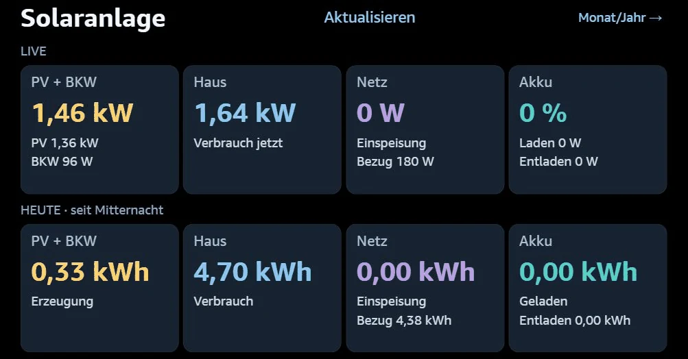
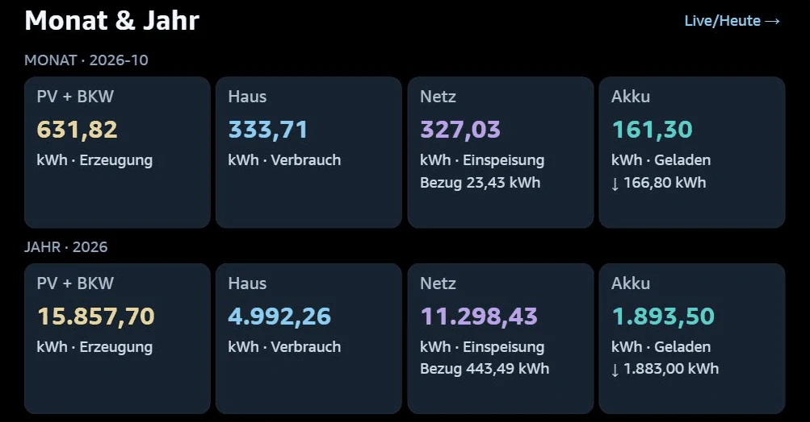
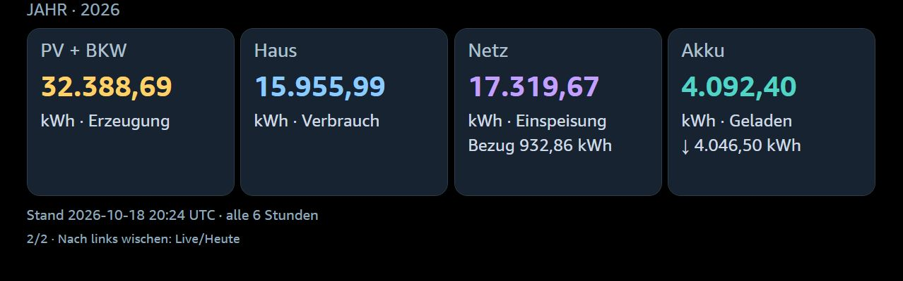
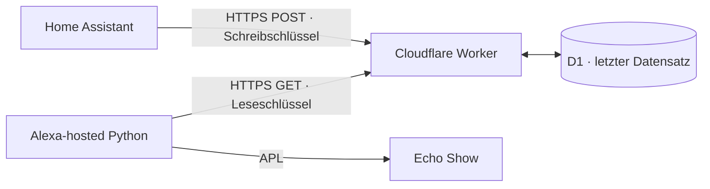

# Solaranlage auf dem Echo Show

<p align="center"></p>

## So sieht Solaranlage aus

**Live-Leistung und Tageswerte**



**Monats- und Jahresübersicht**



Aktuelle Bildschirmaufnahmen der v1 im Alexa-Simulator vom 19. Oktober 2026.
Live-Aufnahme: 09:21 Uhr; Monats-/Jahresdaten: letzter HA-Upload 08:15 Uhr.
Die abgebildeten Messwerte sind Momentaufnahmen der verbundenen Anlage.

## Version 1.0.4 · HACS

Die auf dem Echo Show getestete HACS-Version ist die v1. Der Skill heißt
**Solaranlage** und wird mit **„Alexa, öffne meine Solaranlage.“** gestartet.
Die bestehende Kontoverknüpfung der bisherigen HACS-Beta bleibt erhalten.

**[Einrichtung über HACS und Kontoverknüpfung](docs/HACS.md)** ·
**[Änderungen und Rückkehr zur Vorversion](docs/V1.md)**

**Alexa-Store: am 19. Oktober 2026 zur Zertifizierung eingereicht.**
Der zuletzt bestätigte Amazon-Status lautet **„Wird überprüft“**. Der Skill ist
noch nicht als öffentlich verfügbar bestätigt; bei erfolgreicher Zertifizierung
ist die automatische Veröffentlichung gewählt. Ein Store-Link folgt nach der Freigabe.
HACS installiert die HA-Integration, nicht den Alexa-Skill. Neue Nutzer können
den gemeinsamen Skill erst nach seiner Freigabe regulär aktivieren. Das Relay
benötigt eine persönliche Einladung und ist zunächst auf **20 Haushalte** begrenzt.

[Verfügbarkeit und Einrichtung](docs/ALEXA-STATUS.md) ·
[Datenschutz](https://solaranlage-public-beta.kulmi84.workers.dev/privacy) ·
[Kontakt und Einladung](https://solaranlage-public-beta.kulmi84.workers.dev/contact)

Das Repository ist öffentlich und als benutzerdefiniertes HACS-Repository nutzbar.
Eine Aufnahme in den HACS-Standardkatalog ist noch nicht erfolgt.

**[In HACS hinzufügen](https://my.home-assistant.io/redirect/hacs_repository/?owner=kulmi84&repository=solaranlage-echo-show&category=integration)**

## Alternative: eigene Infrastruktur einrichten

**Unter Windows: `Einrichtung-starten.bat` doppelklicken.**

Der lokale Assistent lädt HA-Sensoren zur Auswahl, erstellt auf Knopfdruck
ein neues Cloudflare-Relay und erzeugt alle Dateien für HA und Alexa.
Datenbank-IDs, Relay-Adresse und Schlüssel werden automatisch übernommen.
Voraussetzungen: Python mit Tcl/Tk, Node.js/npm und die beiden Anbieter-Konten.

➡️ **[Kurze Anleitung zum Einrichtungsfenster](docs/EINFACH-EINRICHTEN.md)**

HA-Packages und der eigene Alexa-Entwickler-Skill müssen anschließend noch
einmalig übernommen bzw. angelegt werden. Bestehende Anlagen werden durch
das Starten des Assistenten nicht verändert.

Ein privater Alexa-Skill zeigt die Solaranlage als native APL-Ansicht auf dem
Echo Show – ohne Silk-Browserleiste. Home Assistant überträgt ausschließlich
die ausgewählten Messwerte per HTTPS an einen geschützten Cloudflare Worker.
Home Assistant braucht dafür keine öffentliche Adresse und keine Portfreigabe.

## 🗣️ Sprachbefehle auf einen Blick

**Anzeige auf dem Echo Show öffnen:**

> **„Alexa, öffne meine Solaranlage.“**

**Werte direkt abfragen – auch auf einem Echo ohne Display:**

| Gewünschter Wert | Sag einfach … |
| --- | --- |
| **Aktuelle Leistung · PV + BKW** | **„Alexa, frage meine Solaranlage nach der aktuellen Leistung.“** |
| **Akkustand** | **„Alexa, frage meine Solaranlage nach dem Akkustand.“** |
| **Aktueller Hausverbrauch** | **„Alexa, frage meine Solaranlage nach dem aktuellen Verbrauch.“** |
| **Heutige Gesamtproduktion · PV + BKW** | **„Alexa, frage meine Solaranlage nach der heutigen Gesamtproduktion.“** |
| **Heutige Einspeisung** | **„Alexa, frage meine Solaranlage nach der heutigen Einspeisung.“** |

**Direkt fragen genügt – der Skill muss vorher nicht geöffnet werden.**
Die Anzeige bleibt beim normalen Öffnen still; gezielte Fragen beantwortet Alexa laut.

**Beenden:** „Alexa, stopp.“

Die Produktion umfasst PV und BKW. Alexa antwortet kurz mit Leistung bzw.
Akkustand. Tagesproduktion und Tageseinspeisung werden seit Mitternacht in
Kilowattstunden angesagt, der aktuelle Hausverbrauch in Watt bzw. Kilowatt.
Fehlende und veraltete Daten werden benannt. Auf dem Echo Show bleibt
das normale Öffnen eine stille Anzeige; nur gezielte Fragen werden gesprochen.

📖 **[Bebilderte Anleitung: Einrichtung, Bedienung und Fehlerbehebung](docs/ANLEITUNG.md)**

## Anzeige

Die beiden Ausschnitte zeigen die Livewerte oben und die Tageswerte darunter
in derselben Echo-Show-Ansicht.

**Livewerte**


**Tageswerte seit Mitternacht**


| Bereich | Live | Heute seit Mitternacht |
| --- | --- | --- |
| PV + BKW | Gesamtleistung, PV-DC-Leistung, BKW-Leistung | Erzeugte Energie |
| Haus | Hausverbrauch | Verbrauchte Energie |
| Netz | Einspeiseleistung und Bezugsleistung | Einspeisung und Bezug |
| Akku | Ladestand, Lade- und Entladeleistung | Geladene und entladene Energie |

Leistungen erscheinen in W bzw. kW, Energiemengen in kWh. HA überträgt jede
Minute. Solange die Anzeige im Vordergrund geöffnet ist, lädt sie die Werte
**automatisch alle 60 Sekunden** nach. **Aktualisieren** bleibt zusätzlich verfügbar.

Der Skill fordert eine Anzeigedauer von **60 Minuten** an. Automatische Abrufe
verlängern diese Zeit nicht; ein erneuter Sprachaufruf oder ein bewusster Tipp
auf **Aktualisieren** startet eine neue Stunde. Alexa kann die angeforderte
Dauer je nach Gerät begrenzen oder ignorieren. Eine dauerhafte Kiosk-Anzeige
ist deshalb nicht garantiert.

Tageswerte stammen aus der HA-Recorder-Statistik und können gegenüber den
Livewerten verzögert sein. Fehlende optionale Werte erscheinen als „—“.
Beim Abruf mehr als drei Minuten alter Daten erscheint eine Warnung.

## Zweite Seite: Monat und Jahr



Der Ausschnitt zeigt die Jahresreihe der zweiten Seite; die Monatsreihe steht
direkt darüber. Die Messwerte sind eine Momentaufnahme vom 18. Oktober 2026.

**Auf der Live-Seite nach rechts wischen**, um Monats- und Jahreswerte zu sehen.
Alternativ **Monat/Jahr →** antippen. Nach links wischen oder **Live/Heute →**
bringt dich zurück. Beide Seiten zeigen PV inklusive BKW, Haus, Netz und Akku.

Die erste Seite aktualisiert sich weiterhin jede Minute. Monats-/Jahresmengen
werden von HA **alle sechs Stunden** (00, 06, 12 und 18 Uhr HA-Ortszeit) sowie
beim HA-Start neu ermittelt und getrennt gespeichert. Die zweite Seite löst
keine Minutenabrufe aus; beim erneuten Öffnen wird der letzte gespeicherte Stand
angezeigt. Monatswerte zählen ab Monatsbeginn, Jahreswerte ab dem 1. Januar.
Alle Mengen sind kWh. Der Stand-Zeitpunkt ist auf der zweiten Seite sichtbar.

Für das Upgrade zuerst `cloudflare/history-schema.sql` auf die bestehende D1
anwenden, dann Worker und Alexa-Code aktualisieren. Das zusätzliche HA-Package
`home-assistant/pv_history.yaml` neben dem bisherigen Package installieren;
vorhandene Secrets werden wiederverwendet. REST-Befehle und Automationen neu
laden und die neue Automation einmal manuell ausführen. Details und Rückkehr:
[Monats-/Jahreswerte einrichten](docs/MONAT-JAHR.md).

## Aufbau



Der Worker speichert nur den letzten Datensatz samt Empfangszeit. Lese- und
Schreibzugriff nutzen getrennte Bearer-Token. Die HA-Zugangsdaten bleiben zu
Hause. Die ausgewählten Energie- und Verbrauchswerte werden bei Cloudflare
gespeichert und beim Aufruf vom Alexa-Backend abgerufen.

## Voraussetzungen

- Home Assistant mit Recorder, passenden Sensoren und YAML-Packages.
- Echo Show und Amazon-Entwicklerkonto; der Skill bleibt im Entwicklungsmodus.
- Cloudflare-Konto mit Workers und D1. Eine eigene Domain ist nicht erforderlich.
- Für die lokale Vorbereitung Python 3.8+ und Node.js mit npm.

Alexa-hosted stellt das Skill-Backend bereit; ein separates AWS-Konto ist für
diese Variante nicht nötig. Es werden keine kostenpflichtigen Pläne benötigt.
Die Nutzung unterliegt den jeweiligen Anbieterlimits und weiteren Projekten
im selben Konto. Das Minutenintervall erzeugt etwa 1.440 Worker-Schreibaufrufe
pro Tag; Anzeigeaufrufe kommen hinzu.

## 1. Cloudflare einrichten

Im Projektordner:

```sh
npx wrangler login
npx wrangler d1 create homeassistant-pv-beta
```

`cloudflare/wrangler.example.jsonc` nach `cloudflare/wrangler.jsonc` kopieren.
Die ausgegebene Datenbank-ID unter `database_id` eintragen. Worker- und
Datenbanknamen bei Bedarf in allen Befehlen und der Konfiguration anpassen.
Die lokale `wrangler.jsonc` wird nicht eingecheckt.

```sh
npx wrangler d1 execute homeassistant-pv-beta --remote --file cloudflare/schema.sql --config cloudflare/wrangler.jsonc
```

Zwei unterschiedliche zufällige Token erzeugen, zum Beispiel zweimal mit:

```sh
python -c "import secrets; print(secrets.token_hex(32))"
```

Diese nur in den privaten Konfigurationen speichern. Die folgenden Befehle
fragen den jeweiligen Wert interaktiv ab:

```sh
npx wrangler secret put READ_TOKEN --config cloudflare/wrangler.jsonc
npx wrangler secret put WRITE_TOKEN --config cloudflare/wrangler.jsonc
npx wrangler deploy --config cloudflare/wrangler.jsonc
```

Die Relay-Adresse lautet `https://DEIN-WORKER.DEIN-SUBDOMAIN.workers.dev/pv`.
Keine Token in URLs einfügen. Ohne korrekten Bearer-Token liefert die Adresse
HTTP 401; das ist erwartetes Verhalten.

**Upgrade einer alten Ein-Wert-Version:** `upgrade-solar.sql` genau einmal statt
einer Neuerstellung ausführen. Die Migration ergänzt `payload_json` und behält
den vorhandenen Datensatz. Neue Installationen brauchen diese Migration nicht.

## 2. Home Assistant einrichten

Die Beispielentitäten in `home-assistant/pv_beta.yaml` auf die eigene Anlage
anpassen. Die enthaltenen IDs sind Beispiele aus einer funktionierenden Anlage:

| Messwert | Beispielentität |
| --- | --- |
| PV inklusive BKW | `sensor.pv_gesamt` |
| PV DC / BKW | `sensor.total_dc_power` / `sensor.bkw_leistung` |
| Hausverbrauch | `sensor.stromverbrauch_haus` |
| Netzbezug / Einspeisung | `sensor.import_power` / `sensor.export_power` |
| Akkustand | `sensor.battery_level` |
| Akku laden / entladen | `sensor.battery_charging_power` / `sensor.battery_discharging_power` |

Für die Tagesstatistik müssen die folgenden **kumulierten Energiezähler** zu
den Quellen im eigenen Energie-Dashboard passen:

| Energiezähler | Beispielentität |
| --- | --- |
| PV / BKW | `sensor.total_pv_generation` / `sensor.bkw_energie` |
| Netzbezug / Einspeisung | `sensor.bitshake_verbrauch` / `sensor.bitshake_einspeisung` |
| Akku laden / entladen | `sensor.total_battery_charge` / `sensor.total_battery_discharge` |

Die Automation liest deren Tagesänderungen ab lokaler Mitternacht in kWh.
Hausenergie = PV + BKW + Netzbezug + Akkuentladung − Einspeisung − Akkuladung.
Die Live-Leistungssensoren müssen W oder kW liefern. Die lokale Zeitzone sollte
in HA auf Europe/Berlin stehen; die Anzeige verwendet ebenfalls Europe/Berlin.

1. Paket z. B. nach `/config/packages/pv_beta.yaml` kopieren.
2. Bestehende `secrets.yaml` um die Einträge aus `secrets.example.yaml` ergänzen.
   Dort die eigene Relay-Adresse und **nur den Schreibschlüssel** eintragen.
3. Packages über die vorhandene HA-Konfiguration laden, z. B.:

   ```yaml
   homeassistant:
     packages: !include_dir_named packages
   ```

   Vorhandene `homeassistant:`-Blöcke zusammenführen, nicht doppelt anlegen.
   Bereits vorhandene Package-Verzeichnisse können weiterverwendet werden.
4. Konfiguration in HA prüfen. Bei Erstinstallation neu starten; bei bestehendem
   Paket genügen das Neuladen von REST-Befehlen und danach Automationen.
5. Die Automation „PV Beta – Messwert übertragen“ aktivieren. Der historische
   interne Name bleibt erhalten, damit Updates keine zweite Automation erzeugen.

`rest_command.pv_beta_upload` erwartet den von der Automation zusammengestellten
Datensatz. Für einen manuellen Test die **Automation** ausführen.

## 3. Alexa-Skill einrichten

1. In der Alexa Developer Console einen **Custom Skill**, Sprache **Deutsch**,
   Hosting **Alexa-hosted (Python)** und Vorlage **Start from Scratch** erstellen.
2. Anzeigename **Solaranlage**, Aufrufname **meine solaranlage**.
3. Das Interaktionsmodell aus `alexa/interaction-model.de-DE.json` importieren
   und bauen. Unter Interfaces **Alexa Presentation Language** aktivieren.
4. Lokal `python build_skill.py` ausführen. Die erzeugte Datei
   `dist/lambda_function.py` vollständig als `lambda/lambda_function.py`
   im Alexa-Codeeditor übernehmen.
5. `relay_config.example.json` lokal kopieren bzw. im Alexa-Codeeditor als
   `lambda/relay_config.json` anlegen. Eigene Adresse und **nur den Leseschlüssel**
   eintragen. Diese Datei niemals veröffentlichen.
6. Speichern und **Deploy** ausführen. Unter Test den Entwicklungsmodus aktivieren.
7. Mit demselben Amazon-Konto auf dem Echo anmelden, den Entwickler-Skill
   aktivieren und „Alexa, öffne meine Solaranlage“ sagen.

Der Builder verbindet Datenleser und Anzeige zu einem Modul, damit auf Alexa
keine lokalen Python-Dateiimporte fehlen. Es sind keine zusätzlichen
Python-Pakete für den Skill notwendig.

## Entwicklung und Tests

```sh
python -m unittest test_beta_live.py
node --test cloudflare/worker.test.mjs
python build_skill.py
```

Die Tests prüfen unter anderem getrennte Berechtigungen, gültige Nullwerte,
fehlende/ungültige Messwerte, veraltete Daten und den Wechsel des Kalendertags.

Für einen echten Verbindungstest eine private `relay_config.json` im
Projektstamm anlegen und `python cloudflare/check_relay.py` ausführen.
Der Test schreibt keine Daten.

## Projektdateien

- `beta_live_reader.py`: Relay abrufen, validieren und Alter prüfen.
- `beta_live_lambda.py`: native APL-Ansicht mit zwei Messwertreihen.
- `build_skill.py`: einzelnes Alexa-Modul erzeugen und Syntax prüfen.
- `cloudflare/`: Worker, Datenbankschema, Migration und Tests.
- `home-assistant/`: Uploadpaket und Secret-Beispiel.
- `alexa/`: deutsches Interaktionsmodell.

Die `beta_`-Dateinamen bleiben zur Kompatibilität mit dem ursprünglichen Prototyp
erhalten. Alte Silk-Launcher, Testbilder, produktive Konfigurationen und
Zugangsdaten gehören nicht zur veröffentlichten Projektversion.

## Ideen und Erweiterungen

[Idee 1: Produktion und Akkustand auf weiteren Alexa-Geräten per Sprache abfragen](docs/IDEEN.md)
ist umgesetzt und dokumentiert.

## Lizenz

MIT, siehe [LICENSE](LICENSE). Der ursprüngliche Lizenzhinweis bleibt erhalten.
