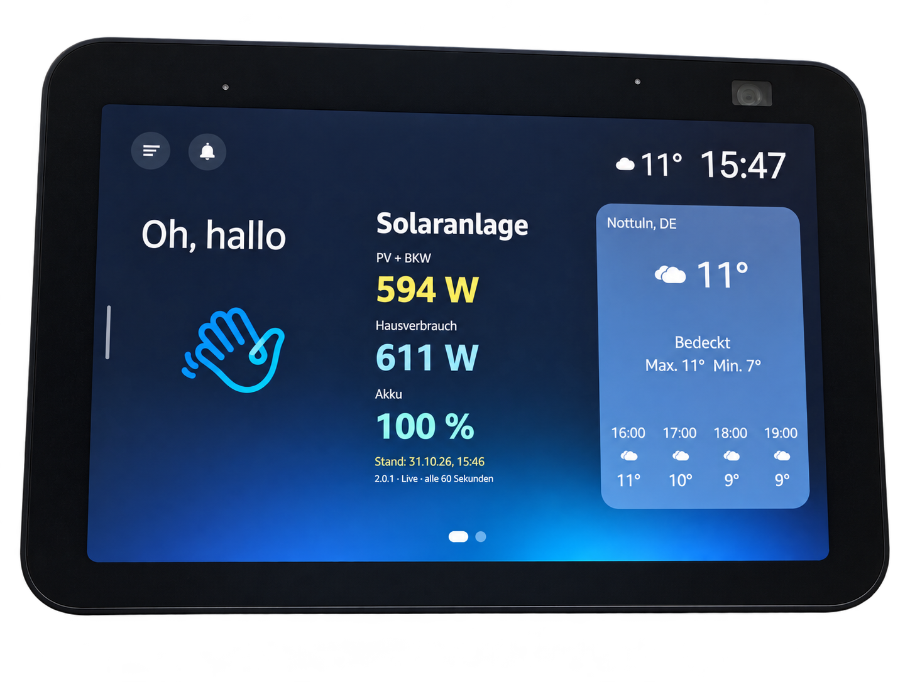

# Solaranlage bedienen

Aktuelle HA-Integration: **1.0.11**. [Einrichtung über HACS](HACS.md).

## Echo Show

**„Alexa, öffne meine Solaranlage.“** öffnet die Vollbildansicht. Sie zeigt aktuelle Leistung, Hausverbrauch, Netz und Akku sowie Tageswerte. Über **Monat/Jahr** gelangst du zu den Energieübersichten.

Das kleine Widget zeigt Solarleistung, Hausverbrauch, Akkustand und Datenstand auf dem Startbildschirm. Antippen öffnet die Vollbildansicht. Neue Bilder ersetzen erst den vollständig geladenen vorherigen Bildsatz.

Die Verfügbarkeit des neuen Widgets im allgemeinen Alexa-Store ist noch offen. [Projektstatus](ALEXA-STATUS.md).

## Sprachfragen – auch ohne Display

- „Alexa, frage meine Solaranlage nach der aktuellen Leistung.“
- „Alexa, frage meine Solaranlage nach dem Akkustand.“
- „Alexa, frage meine Solaranlage nach dem aktuellen Verbrauch.“
- „Alexa, frage meine Solaranlage nach der heutigen Gesamtproduktion.“
- „Alexa, frage meine Solaranlage nach der heutigen Einspeisung.“

## Messwerte auswählen

Die Einrichtung hat zwei Sensorseiten: **Live-Sensoren** für W/kW und %, danach **Energiezähler** für kumulierte Wh/kWh/MWh. Energiezähler sind optional. Fehlende Angaben werden nicht als Null erfunden.

Sensoren lassen sich später in den Integrationsoptionen ändern. Vorhandene Nutzer brauchen für ein Update keine neue Kontoverknüpfung.
