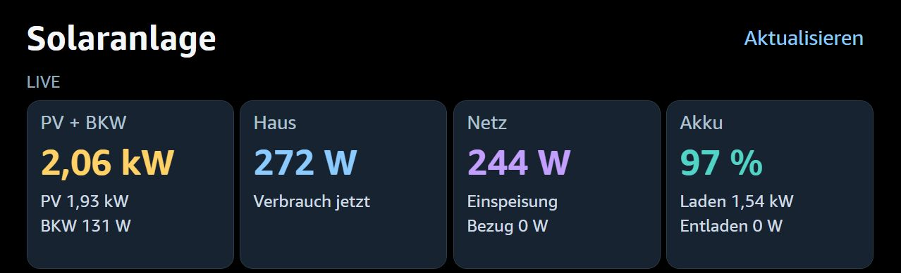
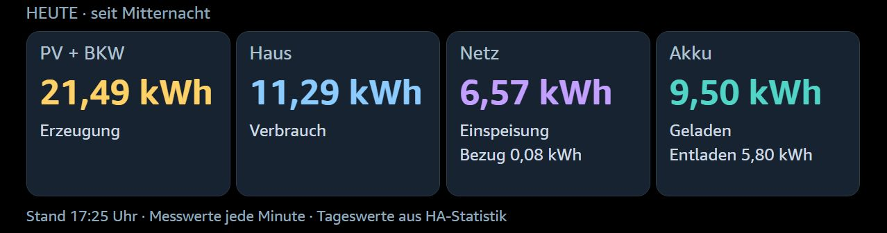
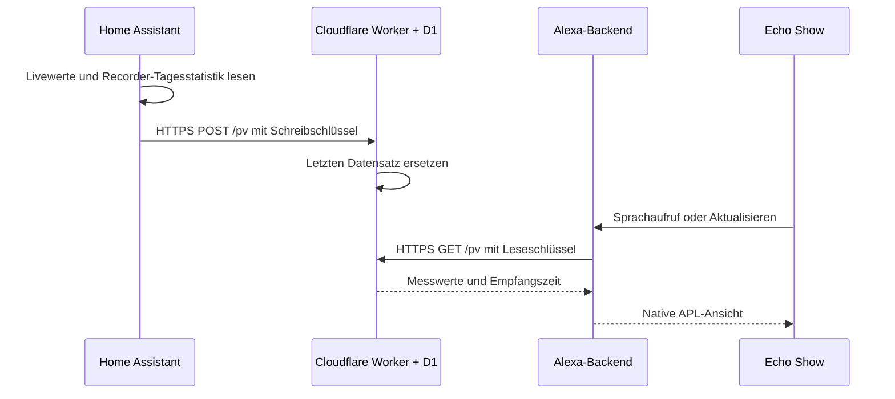
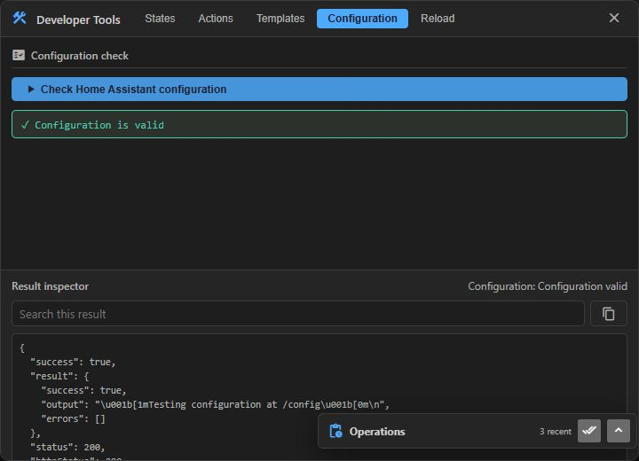
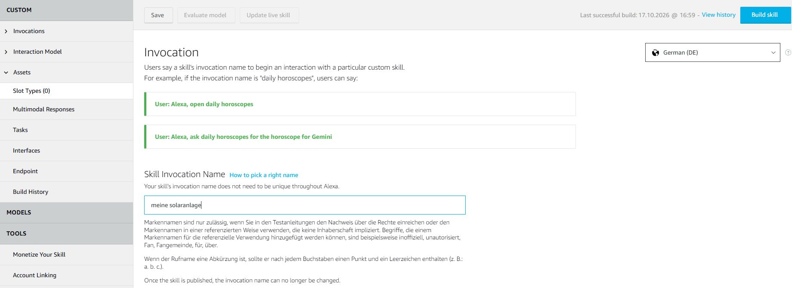

# Solaranlage – bebilderte Anleitung

Neue, getrennte Testinstallation: [Einrichtungsassistent und Schnellstart](SCHNELLSTART.md).
Die bisherige manuelle Anleitung bleibt als Referenz erhalten.

Diese Anleitung beschreibt den privaten Alexa-Skill für den Echo Show:
Installation, Bedienung, Datenquellen und Fehlerbehebung. Die Aufnahmen zeigen
die tatsächlich eingerichtete Anwendung. Messwerte sind Momentaufnahmen und
keine fest eingestellten Beispielwerte.

## 🗣️ Sprachbefehle auf einen Blick

**Anzeige auf dem Echo Show öffnen:**

> **„Alexa, öffne meine Solaranlage.“**

**Werte direkt abfragen – auch auf einem Echo ohne Display:**

| Gewünschter Wert | Sag einfach … |
| --- | --- |
| **Aktuelle Produktion · PV + BKW** | **„Alexa, frage meine Solaranlage nach der aktuellen Produktion.“** |
| **Akkustand** | **„Alexa, frage meine Solaranlage nach dem Akkustand.“** |
| **Aktueller Hausverbrauch** | **„Alexa, frage meine Solaranlage nach dem aktuellen Verbrauch.“** |
| **Heutige Gesamtproduktion · PV + BKW** | **„Alexa, frage meine Solaranlage nach der heutigen Gesamtproduktion.“** |
| **Heutige Einspeisung** | **„Alexa, frage meine Solaranlage nach der heutigen Einspeisung.“** |

**Direkt fragen genügt – der Skill muss vorher nicht geöffnet werden.**
Die Anzeige bleibt beim normalen Öffnen still; gezielte Fragen beantwortet Alexa laut.

**Beenden:** „Alexa, stopp.“

## 1. Was auf dem Echo zu sehen ist

Die native Alexa-Ansicht benötigt keinen Silk-Browser. Sie besteht aus zwei
Reihen mit jeweils vier Karten. Die folgenden Bilder zeigen Ausschnitte der
oberen und unteren Hälfte **derselben Ansicht**.

### Oben: Livewerte



| Karte | Großer Wert | Weitere Angaben |
| --- | --- | --- |
| PV + BKW | Gemeinsame aktuelle Leistung | PV-DC-Leistung und BKW einzeln |
| Haus | Aktueller Hausverbrauch | Leistung in W oder kW |
| Netz | Aktuelle Einspeisung | Netzbezug darunter separat |
| Akku | Ladezustand in Prozent | Lade- und Entladeleistung |

Die Gesamtleistung kommt aus `sensor.pv_gesamt`. Sie enthält das BKW bereits;
die separat angezeigte BKW-Leistung wird im Skill **nicht nochmals addiert**.

### Darunter: Tageswerte



| Karte | Angezeigte Energie seit lokaler Mitternacht |
| --- | --- |
| PV + BKW | Gemeinsam erzeugte Energie |
| Haus | Verbrauchte Energie |
| Netz | Einspeisung und Netzbezug getrennt |
| Akku | Geladene und entladene Energie getrennt |

Alle Tagesmengen werden in **kWh** angezeigt. Ein Wert von 2 kW bezeichnet eine
momentane Leistung; 2 kWh bezeichnet eine aufsummierte Energiemenge.

Die Tageswerte beruhen auf denselben Energiezählern wie die eingerichtete
HA-Energiekarte. Sie stammen aus der Recorder-Statistik. Dadurch können sie
gegenüber aktuellen Sensorwerten verzögert sein. Es handelt sich nicht um
Monats-, Jahres- oder Lebensdauerzähler.

## 2. Bedienung

1. Auf dem Echo **„Alexa, öffne meine Solaranlage“** sagen.
2. Die Werte werden im Vordergrund **alle 60 Sekunden automatisch** nachgeladen.
   Zum sofortigen Abrufen **Aktualisieren** oben rechts antippen.
3. Alternativ den Skill schließen und erneut öffnen.
4. Mit **„Alexa, stopp“** beenden.

Die Anzeige fordert nach dem Öffnen, Antippen oder automatischen Aktualisieren
keine Spracheingabe an. Dafür bleibt `shouldEndSession` in APL-Antworten bewusst
ungesetzt. Normale Alexa-Befehle mit **„Alexa, …“** beginnen. Ob Alexa einen Befehl
an ihre allgemeinen Funktionen oder die noch aktive Skill-Sitzung weitergibt,
entscheidet die Plattform; andere Funktionen können die Anzeige verlassen.
Ein dauerhaft gleichzeitiger Betrieb aller Alexa-Funktionen und der Anzeige
wird vom Skill nicht erzwungen.

Home Assistant überträgt einmal pro Minute. Die geöffnete Anzeige ruft den
zuletzt empfangenen Datensatz automatisch alle 60 Sekunden ab. Upload und
Abruf laufen unabhängig; einzelne Sensoränderungen können daher erst nach
bis zu etwa zwei Intervallen auf dem Echo erscheinen. Netzwerk- und
Recorder-Verzögerungen kommen gegebenenfalls hinzu.

### Länger geöffnet lassen

Der Skill fordert **60 Minuten Anzeigedauer** an. Automatische Abrufe behalten
das ursprüngliche Ende dieser Stunde bei, statt die Anzeige bei jedem Abruf
um eine weitere Stunde zu verlängern. Ein bewusster Tipp auf **Aktualisieren**
oder ein erneuter Sprachaufruf startet eine neue Stunde.

Die Zeitvorgabe ist laut Amazon eine Empfehlung: Das Gerät kann sie begrenzen
oder ignorieren. Andere Alexa-Funktionen können die Ansicht unterbrechen.
Die Funktion ist daher kein garantierter Dauer- oder Kioskbetrieb. Im
Hintergrund werden keine regelmäßigen Abrufe angefordert.

Technik: `settings.idleTimeout` fordert die verbleibende Anzeigedauer an.
`handleTick` sendet alle 60 Sekunden ein `auto_refresh`-Ereignis an das Backend.
Ein benannter Sequencer ermöglicht `SendEvent` aus dem Tick-Handler.
Siehe [Amazon: Tick-Handler](https://developer.amazon.com/en-US/docs/alexa/alexa-presentation-language/apl-tick-event-handlers.html)
und [APL-Dokumenteinstellungen](https://www.developer.amazon.com/en-US/docs/alexa/alexa-presentation-language/apl-document.html#idletimeout).

Die Zeile **Stand … Uhr** bezeichnet die Empfangszeit des Datensatzes beim
Relay. Sie ist keine Zusage, dass jeder einzelne Sensor exakt gleichzeitig
gemessen wurde. Die Zeitdarstellung verwendet Europe/Berlin.

Fehlende optionale Werte erscheinen als **—**. Bei einem Abruf, dessen Datensatz
älter als drei Minuten ist, erscheint **VERALTET**. Scheitert der Abruf, werden
keine aktuellen Daten vorgetäuscht. Nach einem Tageswechsel werden Werte des
Vortags nicht unter „Heute“ weitergeführt.

## 3. Datenweg



Home Assistant baut die Verbindung nach außen auf. Eine Portweiterleitung,
ein Tunnel oder ein öffentlich erreichbarer HA-Server ist hierfür nicht nötig.
Ein eigener Domainname ist ebenfalls nicht erforderlich.

Die ausgewählten Solar-, Verbrauchs- und Energiewerte werden an Cloudflare
übertragen und beim Öffnen vom Alexa-Backend gelesen. D1 hält nur den neuesten
Datensatz. Der Worker verwendet zwei getrennte Schlüssel:

| Schlüssel | Aufbewahrungsort | Zweck |
| --- | --- | --- |
| `WRITE_TOKEN` | Cloudflare Secret und HA `secrets.yaml` | Messwerte schreiben |
| `READ_TOKEN` | Cloudflare Secret und Alexa `relay_config.json` | Messwerte lesen |

HA-Passwort und HA-Zugriffstoken werden für diesen Datenweg nicht benötigt.
Die produktiven Schlüssel und Konfigurationen sind vom Git-Repository ausgeschlossen.

## 4. Cloudflare einrichten

Die ausführbaren Befehle und Beispielkonfigurationen stehen in der
[Hauptanleitung](../README.md#1-cloudflare-einrichten).

1. Bei Cloudflare anmelden und eine D1-Datenbank anlegen.
2. `cloudflare/wrangler.example.jsonc` nach `cloudflare/wrangler.jsonc` kopieren.
3. Die eigene Datenbank-ID eintragen. Der Binding-Name muss **DB** heißen.
4. Bei einer neuen Installation `cloudflare/schema.sql` ausführen.
5. Zwei unterschiedliche zufällige Token als Worker-Secrets `READ_TOKEN` und
   `WRITE_TOKEN` anlegen.
6. Den Worker bereitstellen. Die Relay-Adresse endet auf **`/pv`**.

**Wichtig beim Upgrade:** `upgrade-solar.sql` ergänzt die alte Ein-Wert-Version.
Die Migration genau einmal auf die alte Datenbank anwenden; nach einer
Neuinstallation mit `schema.sql` ist sie nicht nötig.

Ein normaler Browseraufruf ohne Leseschlüssel liefert **HTTP 401**. Das ist
korrekt und bedeutet allein nicht, dass der Worker defekt ist.

## 5. Home Assistant einrichten

### Entitäten zuordnen

Vor der Installation die Entitäten im Paket an die eigene Anlage anpassen.
Die vollständige Zuordnung steht in der
[Hauptanleitung](../README.md#2-home-assistant-einrichten).

Für Liveleistungen sind Sensoren mit **W** oder **kW** erforderlich.
Der Akkustand wird in Prozent erwartet. Die Energiequellen müssen kumulierte
Zähler mit Recorder-Statistik sein, keine geschätzte Solarprognose.

Die Tagesberechnung verwendet die Änderungen von sechs Energiezählern:

```text
PV-Erzeugung + BKW-Erzeugung
Netzbezug / Netzeinspeisung
Akkuladung / Akkuentladung
```

Die Hausenergie wird bilanziert:

```text
Haus = PV + BKW + Netzbezug + Akkuentladung − Einspeisung − Akkuladung
```

### Paket laden

1. `home-assistant/pv_beta.yaml` in ein bereits eingebundenes Package-Verzeichnis
   kopieren oder Packages wie in der Hauptanleitung aktivieren.
2. Die zwei Einträge aus `home-assistant/secrets.example.yaml` in die vorhandene
   HA-`secrets.yaml` übernehmen und mit der eigenen URL und dem Schreibschlüssel
   ausfüllen. Vorhandene Einträge behalten.
3. Die vollständige HA-Konfiguration prüfen.
4. Bei Erstinstallation HA neu starten. Bei einem bestehenden Paket REST-Befehle
   und anschließend Automationen neu laden.
5. Die Automation **PV Beta – Messwert übertragen** eingeschaltet lassen.

Die Aufnahme zeigt die Konfigurationsprüfung im verwendeten Zusatzeditor
**Blueprint Studio**. Dieser Editor ist optional; die Dateien lassen sich auch
mit einem anderen HA-Dateieditor bearbeiten.



Zum manuellen Test die **Automation** ausführen. Der REST-Befehl erwartet den
von ihr zusammengestellten Datensatz und ist kein eigenständiger Testknopf.

## Solarwerte per Sprache abfragen

Auch auf einem Echo ohne Display:

- **„Alexa, frage meine Solaranlage nach der aktuellen Produktion.“**
- **„Alexa, frage meine Solaranlage nach dem Akkustand.“**
- **„Alexa, frage meine Solaranlage nach dem aktuellen Verbrauch.“**
- **„Alexa, frage meine Solaranlage nach der heutigen Gesamtproduktion.“**
- **„Alexa, frage meine Solaranlage nach der heutigen Einspeisung.“**

Die Produktion ist die aktuelle Gesamtleistung inklusive BKW, keine
Tagesenergiemenge. Der aktuelle Verbrauch ist die Hausleistung in Watt bzw.
Kilowatt. Heutige Gesamtproduktion inklusive BKW und heutige Einspeisung sind
Tagesenergiemengen seit Mitternacht in Kilowattstunden. Sie stammen wie die
Anzeige aus der HA-Tagesstatistik und können verzögert sein. Der Akkustand
wird in Prozent angesagt.
Ohne Display endet der Skill nach der Antwort. Auf einem Echo Show wird bei
gezielten Fragen zusätzlich die Anzeige dargestellt; normales Öffnen und
Minutenabrufe bleiben still. Fehlende Daten und veraltete Messwerte werden
ausdrücklich angesagt.

Bei einem Update auf diese Version sowohl das Interaktionsmodell erneut
importieren und bauen als auch den neu erzeugten Python-Code deployen.

| Frage nach … | Bedeutung | Gesprochene Einheit |
| --- | --- | --- |
| aktueller Produktion | PV-Gesamtleistung inklusive BKW | Watt / Kilowatt |
| Akkustand | Ladezustand der Batterie | Prozent |
| aktuellem Verbrauch | Momentaner Hausverbrauch | Watt / Kilowatt |
| heutiger Gesamtproduktion | PV und BKW seit lokaler Mitternacht | Kilowattstunden |
| heutiger Einspeisung | Ins Netz abgegebene Energie seit lokaler Mitternacht | Kilowattstunden |

Für einen Test auf einem weiteren Echo denselben Amazon-Account wie für den
Entwickler-Skill verwenden. Eine gezielte Frage direkt mit dem vollständigen
Aufruf stellen; vorheriges Öffnen ist nicht erforderlich. Ohne Display endet
die Sitzung nach der Antwort.

## 6. Alexa-Skill einrichten

### Skill und Aufrufname

In der Alexa Developer Console einen **Custom Skill** mit **Deutsch (DE)**,
**Alexa-hosted (Python)** und **Start from Scratch** anlegen.

- Anzeigename: **Solaranlage**
- Aufrufname: **meine solaranlage**

Der Anzeigename und der Sprachaufruf sind unterschiedliche Einstellungen.
Die Konsole akzeptiert bei diesem Skill keinen Aufrufnamen mit nur einem Wort.



1. `alexa/interaction-model.de-DE.json` als deutsches Interaktionsmodell importieren.
2. Speichern und **Build skill** ausführen. Auf den erfolgreichen Abschluss warten.
3. Unter **Interfaces** die **Alexa Presentation Language (APL)** aktivieren.

### Code bereitstellen

```sh
python build_skill.py
```

Der Builder erzeugt `dist/lambda_function.py`. Dessen vollständigen Inhalt in
`lambda/lambda_function.py` im Alexa-Codeeditor übernehmen. Die beiden lokalen
Quelldateien müssen dort nicht einzeln hochgeladen werden.

`relay_config.example.json` als Vorlage verwenden. Im Alexa-Codeeditor eine
Datei `lambda/relay_config.json` mit eigener Relay-Adresse und Leseschlüssel
anlegen. Danach **Save** und **Deploy** ausführen und das Deployment abwarten.

Ein separates AWS-Konto ist für diese Alexa-hosted-Variante nicht erforderlich.

### Entwicklungsmodus und Echo

1. Unter **Test** den Entwicklungsmodus **Development** einschalten.
2. Im Simulator **German (DE)** wählen und `öffne meine solaranlage` eingeben.
3. **Device Display** aktivieren. **Skill I/O** kann für eine größere Vorschau
   ausgeschaltet werden; zum Debuggen zeigt es Anfrage und Antwort.
4. Auf dem Echo dasselbe Amazon-Konto verwenden und den Entwickler-Skill in der
   Alexa-App aktivieren.
5. Auf dem Echo **„Alexa, öffne meine Solaranlage“** sagen.

Der Skill wird hierfür nicht öffentlich im Skill Store veröffentlicht.

## 7. Fehlerbehebung

| Beobachtung | Prüfen / Abhilfe |
| --- | --- |
| Alexa findet den Skill nicht | Exakten Aufruf „meine Solaranlage“, deutsches Sprachmodell, erfolgreichen Build, Entwicklungsmodus und dasselbe Amazon-Konto prüfen. |
| Neue Sprachabfrage wird nicht erkannt | Aktuelles Interaktionsmodell importieren, speichern und erfolgreich bauen; zusätzlich den passenden Python-Code deployen. Mit einem der vollständigen Beispielaufrufe testen. |
| „Bei der Antwort … ist ein Problem aufgetreten“ | Deployment abwarten; die vom Builder erzeugte vollständige Datei verwenden. Bei Bedarf die Alexa-hosted-CloudWatch-Logs der verwendeten Region lesen. |
| Silk öffnet sich | Der alte Browser-Skill wurde gestartet. Den Skill „Solaranlage“ mit „öffne meine Solaranlage“ aufrufen. |
| Nur — / Verbindung prüfen | Relay-Adresse inklusive `/pv`, Leseschlüssel, Worker-Secrets und Internetverbindung prüfen. |
| VERALTET | HA-Automation, Sensorverfügbarkeit und letzten erfolgreichen Upload prüfen; danach Aktualisieren antippen. |
| Zahl ändert sich auf dem Echo nicht | Bis zu zwei Minuten abwarten oder Aktualisieren antippen. Stand-Zeit prüfen; die Ansicht muss im Vordergrund sein. Bei älterem Skillstand die aktuelle Version deployen. |
| Anzeige schließt früher als nach einer Stunde | Die 60 Minuten sind eine Anforderung an Alexa. Gerätebegrenzungen und Unterbrechungen können früher schließen; erneut öffnen und am eigenen Echo prüfen. |
| Tageswerte unterscheiden sich von HA | Dieselben kumulierten Zähler, lokalen Tageszeitraum, Einheiten und Aktualisierungsstand der Recorder-Statistik vergleichen. |
| Einzelner Wert fehlt | Zustand und Einheit der betreffenden Entität prüfen. `unknown` und `unavailable` werden nicht als Null ausgegeben. |
| PV-Gesamt scheint zu groß | Prüfen, ob der Gesamtsensor das BKW bereits enthält. Die Gesamtleistung nicht nochmals um das BKW erhöhen. |
| Worker liefert HTTP 401 | Zum Test den passenden Bearer-Token verwenden. Lese- und Schreibschlüssel sind nicht austauschbar. |

## 8. Änderungen und Wartung

| Änderung | Erforderlicher Schritt |
| --- | --- |
| Entitäten / HA-Uploadpaket | Konfiguration prüfen; REST-Befehle und Automationen neu laden. |
| Python-Anzeige / Relay-Leser | Builder ausführen, erzeugten Alexa-Code ersetzen, speichern und deployen. |
| Sprachaufruf / Interaktionsmodell | Speichern und Sprachmodell neu bauen. |
| Worker-Code | Mit Wrangler erneut deployen. |
| Token | Passendes Cloudflare Secret und zugehörige private HA- oder Alexa-Konfiguration gemeinsam aktualisieren. |

Quellcode-Änderungen auf GitHub werden nicht automatisch in HA, Cloudflare
oder Alexa bereitgestellt. Die produktive Konfiguration bleibt lokal.

Vor einem Update können die lokalen Tests ausgeführt werden:

```sh
python -m unittest test_beta_live.py
node --test cloudflare/worker.test.mjs
python build_skill.py
```

Die Screenshots wurden am **17. Oktober 2026** aufgenommen. Bezeichnungen und
Menüs können je nach Sprache und Produktversion abweichen.
