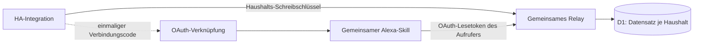

# Solaranlage v1.0.9 über HACS

**Update 1.0.8:** Bild-Widget-Quellen und Dokumentation aktualisiert. Die HA-Funktionen und Kontoverknüpfung bleiben erhalten. Eine HACS-Aktualisierung ersetzt keine Amazon-Widget-Veröffentlichung. [Verfügbarkeit und Rücksprung](V1.0.8.md).

**Version 1.0.6:** Die Solaranzeige aktualisiert sich alle 60 Sekunden bei geschlossener Sprachsitzung. Ein eigener Anzeigezugang ermöglicht bis zu 24 Stunden; danach erneut öffnen. [Update und Rückkehr](V1.0.6.md).

## Version 1.0.5: Anzeige ohne offene Sprachsitzung

Das Dashboard wird beim Öffnen angezeigt, während die Sprachsitzung sofort endet. Bildschirmaktualisierungen halten die Sprachsitzung ebenfalls geschlossen. Es gibt keine Abschiedsansage. Normale Alexa-Befehle können so wieder direkt verarbeitet werden; Wetter- oder Smart-Home-Karten können die Solaranzeige ersetzen. Eine automatische Rückkehr wird nicht erzwungen.

Die Änderung wurde auf dem Echo Show in der separaten Testversion erfolgreich erprobt. Verhalten und Anzeigedauer bestimmt weiterhin auch das jeweilige Alexa-Gerät. Live-Werte und Kontoverknüpfung werden unverändert verwendet. Ein HA-Neustart oder erneutes Verknüpfen ist für dieses Alexa-Codeupdate nicht erforderlich.

[Änderung und Rückkehr zu 1.0.4](V1.0.5.md) · [1.0.4 bleibt verfügbar](https://github.com/kulmi84/solaranlage-echo-show/releases/tag/v1.0.4)


Die HACS-Version wurde mit echten Messwerten und Kontoverknüpfung auf einem Echo
Show geprüft. Der Skill heißt **Solaranlage**, Sprachaufruf **meine solaranlage**.
Der normale [Alexa-Skill Solaranlage](https://www.amazon.de/dp/B0HN5CSTW6/) wurde am 28. Oktober 2026 in der Amazon-Konsole als **Live** bestätigt. Der neue Bild-Widget-Entwicklungsstand ist davon getrennt und noch nicht allgemein veröffentlicht.
Der Kontodienst erlaubt die Einrichtung ohne Einladung, solange Kapazität frei ist (höchstens 20 Haushalte). Neue Konten sind zum Schutz vor Missbrauch je Internetanschluss begrenzt. Das GitHub-Repository
ist öffentlich und kann in HACS als benutzerdefiniertes Repository hinzugefügt werden.

## Update 1.0.9: Einrichtung ohne Einladung

Bestehende Einrichtungen übernehmen beim Start automatisch die neue Adresse `https://solaranlage-kontodienst.kulmi84.workers.dev`. Konto, Zugangsdaten, Sensorauswahl und Alexa-Verknüpfung bleiben erhalten. Ist der neue Dienst nicht erreichbar, bleibt die bisherige Adresse erhalten. Eigene Relay-Adressen werden nicht verändert. Neue Einrichtungen verwenden direkt den Kontodienst.

Die PV-/BKW-Felder erklären Pflichtwert und optionale Einzelwerte. Die Integration erkennt den freigegebenen Anmeldeweg des Servers: automatische Kontoanlage nach Bestätigen des Hinweises oder weiterhin Einladung. Alte Server ohne diese Erkennung bleiben beim Einladungsweg. Der gemeinsame Kontodienst ist seit dem 31. Oktober 2026 freigeschaltet. [Ablauf und Prüfungen](PUBLIC-ENROLLMENT.md).

Der alte Data-Store-Versuch einschließlich seiner Weiterleitung ist archiviert und stillgelegt. Die zwei verbleibenden alten Adressen (Kontodienst und Bilder) dürfen erst nach erfolgreichem Update der externen Haushalte und Umstellung der Alexa-/Bildkonfigurationen entfernt werden. HACS aktualisiert die Alexa-Konfigurationen nicht automatisch. Danach bleiben Kontodienst, Bilder und Mein Zuhause sowie der separate Tageslimit-Warn-Worker.

## Der neue Ablauf für Nutzer

Die Skill-Aktivierung in Schritt 4 setzt die Amazon-Freigabe oder bereits
vorhandenen Entwicklerzugriff voraus. [Status und Voraussetzungen](ALEXA-STATUS.md).

1. `https://github.com/kulmi84/solaranlage-echo-show` als benutzerdefiniertes Repository in HACS
   hinzufügen und **Solaranlage Echo Show** herunterladen. HA neu starten.
2. Einstellungen → Geräte & Dienste → Integration hinzufügen →
   **Solaranlage Echo Show**. Den voreingestellten Dienst verwenden. Eine Einladung wird nur abgefragt, wenn ein eigener oder älterer Server sie verlangt.
3. Live-Sensoren und kumulierte Energiezähler auswählen und der Übertragung
   mit **Verbinden und übertragen** starten. Keine YAML-Dateien, HA-Zugangstoken oder eigenen Cloudflare-Konten.
4. In den Integrationsoptionen **Alexa verbinden** wählen. Den einmaligen,
   zehn Minuten gültigen Code kopieren. In der Alexa-App den gemeinsamen Skill
   aktivieren und den Code auf seiner Verknüpfungsseite einfügen.
5. „Alexa, öffne meine Solaranlage.“ Die bekannten Sprachfragen und beide
   Anzeigeseiten bleiben erhalten.

Der Verbindungscode ist lang, damit er nicht erraten werden kann. Er wird
kopiert und eingefügt, nicht auf dem Echo diktiert. Er ersetzt einen eigenen
Benutzernamen und ein Passwort beim Relay.

Die Skill-URL wird nach der Amazon-Freigabe ergänzt. Für den derzeitigen
Entwicklerbetrieb muss der Echo dasselbe Amazon-Konto wie die Developer Console
verwenden. Eine neue Kontoverknüpfung ist bei der Umbenennung der HACS-Beta nicht nötig.

## Sensorauswahl

- **Gesamte Solarleistung (Pflicht):** Sensor in W/kW auswählen. Ohne BKW ist das einfach die PV-Leistung. Mit BKW muss dieser Sensor PV + BKW bereits enthalten; die Integration addiert die Einzelfelder nicht automatisch.
- **PV-Anlage einzeln** und **Balkonkraftwerk einzeln** sind optional und dienen der getrennten Anzeige in der Vollbildansicht. Ohne BKW dürfen beide Felder leer bleiben. Das kleine Widget zeigt die Gesamtleistung.
- Die Sprachabfrage zur Erzeugung nennt die Gesamtleistung; getrennte PV-/BKW-Sprachabfragen sind derzeit nicht hinterlegt.
- Weitere Leistungen und Akkustand in Prozent sind optional.
- **Hausverbrauch prüfen:** Eine Energieflusskarte kann diesen Wert selbst berechnen.
  Ein gleichnamiger Sensor muss nicht dieselbe Berechnung liefern. Vergleiche die
  Auswahl mit der Karte. Die Bilanz lautet: PV inklusive BKW + Netzbezug +
  Akkuentladung − Einspeisung − Akkuladung. Für die getestete Anlage wird ein
  eigener Template-Helfer mit dieser Bilanz als Hausverbrauch ausgewählt.
- Energiezähler in Wh/kWh/MWh müssen kumulierte Recorder-Zähler sein
  (`total`/`total_increasing`). Keine täglich zurückgesetzten Anzeigehelfer.
- Der PV-Energiezähler enthält das separat gewählte BKW nicht bereits.
  Doppelt ausgewählte Energiezähler werden abgewiesen.
- Fehlende Werte bleiben unbekannt. Für die berechnete Hausenergie sind alle
  sechs Energiequellen erforderlich. Bei nicht vorhandenen BKW/Akku-Komponenten
  sind bewusst definierte Nullzähler erforderlich; Abwesenheit wird nicht geraten.

Live-/Tageswerte werden minütlich übertragen. Monat und Jahr werden beim Start
und nach einem Wechsel des lokalen Sechs-Stunden-Fensters ermittelt. Nach
vorübergehend fehlender Recorder-Statistik wird erneut versucht. Ein lokaler
Verbindungssensor zeigt letzten Upload, Status und fehlende Messwertarten.
Die Integration überträgt keine Entitäts-IDs oder HA-Zugangsdaten.

Die vorhandenen Statistiken bestimmen den verfügbaren Zeitraum. Daten aus
Zeiten vor der Recorder-Erfassung werden nicht nachträglich erfunden.

## Änderungen und Entfernen

Sensoren lassen sich in den Integrationsoptionen ändern. Änderungen laden die
Integration neu. **Relay-Daten und Verknüpfung löschen** entfernt nach ausdrücklicher
Bestätigung alle gespeicherten Relay-Messwerte und Zugriffsberechtigungen dieses
Haushalts. Anschließend die Integration in HA entfernen. Zum erneuten Einrichten
ist eine neue Einladung nötig.

Das bloße Entfernen der lokalen HA-Integration löscht Remote-Daten nicht. Wenn
HA nicht mehr erreichbar ist, muss der Betreiber den betreffenden Haushalt auf
Anfrage aus der Relay-Datenbank entfernen. Deshalb erst im Optionsdialog löschen.

## Betreiber: gemeinsames Relay

**Betriebsstand vom 19. Oktober 2026:** Die aktive D1-Datenbank heißt
`solaranlage`, das Worker-Binding weiterhin `DB`. Der bisherige Datenbankstand
wurde vollständig übertragen und geprüft; `solaranlage-public-beta` wurde danach
gelöscht. Worker-Name, Relay-URL und OAuth-Client-ID bleiben zur Kompatibilität
unverändert. Bestehende Nutzer müssen nichts neu verknüpfen.
Details und Wiederherstellung: [Datenbank und Sicherung](DATENBANK.md).

Der neue Code liegt in `cloudflare/public-beta/`; er verwendet eine **neue**
D1-Datenbank und andere Tabellen. Den bestehenden Einzelanlagen-Worker nicht
ersetzen und die bisherige Datenbank nicht für diese Migration verwenden.

1. Neue D1-Datenbank erstellen; `wrangler.example.jsonc` in eine private
   `wrangler.jsonc` kopieren und nur deren neue Datenbank-ID einsetzen.
2. `schema.sql` auf diese neue Datenbank anwenden. `ADMIN_TOKEN` und
   `OAUTH_CLIENT_SECRET` als zwei getrennte zufällige 32-Byte-Secrets setzen.
   Nicht committen. Vorhandene produktive Secrets nicht wiederverwenden.
3. In der separaten Alexa-Entwicklungsversion Account Linking konfigurieren:

   | Einstellung | Wert |
   | --- | --- |
   | Verfahren | Authorization Code Grant, PKCE mit SHA-256 |
   | Authorization URI | `https://NEUES-RELAY/oauth/authorize` |
   | Token URI | `https://NEUES-RELAY/oauth/token` |
   | Client ID | `solaranlage-public-beta` |
   | Client Secret | eigenes `OAUTH_CLIENT_SECRET` |
   | Client-Authentifizierung | HTTP Basic oder Credentials im POST-Body |
   | Scope | `solar:read` |

4. Ausschließlich die **exakten Alexa Redirect URLs aus dieser Skill-Konsole**
   in `OAUTH_REDIRECT_URIS` als JSON-Liste eintragen. Keine Wildcards. Bei leerer
   Liste bleibt OAuth gesperrt. Worker deployen. `LIMITER` muss gebunden sein;
   ohne dieses Binding verweigert die API Anfragen.
5. In `custom_components/solaranlage_echo/const.py` den neuen Relay-Origin
   prüfen. Die Voreinstellung bezeichnet den bestehenden Relay-Worker und ist
   keine Zusicherung, dass er bereits bereitgestellt wurde.
6. Separate Alexa-Konfiguration nach `alexa/relay_config.public.example.json`
   erstellen, `mode: public_beta` und die neue `/v1/pv`-Adresse verwenden.
   `python build_skill.py` erzeugt das Backend. Nur die neue Skill-Testversion
   damit bereitstellen; die eigene laufende Skill-Version bleibt unangetastet.
7. Eine private Admin-Datei mit `relay_url` und `admin_token` erstellen. Einladung:

   ```sh
   python cloudflare/public-beta/admin.py --config .private/beta-admin.json --out .private/einladung-1.json
   ```

   Die Einladung ist einmalig und sieben Tage gültig. Sie enthält ein Geheimnis,
   ist nur für den jeweiligen Tester bestimmt und gehört nicht in GitHub.
   Höchstens 20 Haushalte können sich registrieren.

## Trennung und Grenzen



Tokens werden serverseitig nur gehasht gespeichert. Alexa bekommt ausschließlich
Lesezugriff auf den verknüpften Haushalt. Zugriffstokens gelten eine Stunde;
Refresh-Tokens rotieren und gelten maximal 90 Tage. Verknüpfungs- und
Autorisierungscodes sind einmalig. Löschung eines Haushalts widerruft alle Tokens.
IP-Limits und zeitliche Upload-Limits schützen vor einfachen Wiederholungen;
sie sind keine Garantie gegen verteilten Missbrauch oder gegen das Erreichen
der gemeinsamen Cloudflare-Kontolimits. Das Relay ist keine Steuer-API.

Es werden jeweils nur letzte Messwerte und aktuelle Tages-/Monats-/Jahresmengen
gespeichert, keine komplette Messwerthistorie. Ohne ausdrückliche Löschung
bleibt der letzte Haushaltsdatensatz bestehen. Abgelaufene Codes/Tokens räumt
ein täglicher Cron auf. Eine Datenschutzbeschreibung für den öffentlichen
Betrieb muss diese Speicherung, Betreiberkontakt und Löschmöglichkeit nennen.

## Stand der Prüfung und Freigabe

Automatisierte Tests prüfen Umrechnung, fehlende Werte, HA-Dialogübergänge,
Upload-Zeitsteuerung und Relay-Transport. Die HA-Framework-Grenzen verwenden
Test-Doubles; eine Installation in einer echten HA-Testinstanz steht noch aus.
Die Worker-Tests führen Registrierung, OAuth, PKCE, Token-Erneuerung und
Haushaltstrennung gegen eine echte lokale SQLite-Datenbank aus. Bestehende
Anzeige- und Sprachtests werden zusätzlich ausgeführt.

Das gemeinsame Relay wurde am 18. Oktober 2026 bereitgestellt. Installation
über HACS, minütliche Übertragung, iOS-Kontoverknüpfung und beide Anzeigeseiten
wurden mit einer echten Anlage geprüft. Die getestete Version wurde am
19. Oktober als v1.0.0 veröffentlicht. v1.0.1 aktualisiert Anleitungen,
Einrichtungstexte und die im Release enthaltenen Bildschirmaufnahmen.

## Anzeige in HACS aktualisieren

HACS liest Repository- und Release-Daten nicht immer sofort neu ein. Im
Repository-Menü **Informationen aktualisieren** verwenden, sofern angeboten,
und die Ansicht neu laden. Prüfe, ob **1.0.4** als aktuelle Version angezeigt wird.
**Herunterladen/Erneut herunterladen** aktualisiert die Integration; damit neue
Einrichtungsübersetzungen geladen werden, kann anschließend ein HA-Neustart
nötig sein. Die README in HACS und die installierte Integrationsversion sind
unterschiedliche Dinge. Bestehende Sensoren und die Kontoverknüpfung bleiben erhalten.

## Integrationssymbol und HACS-Platzhalter

Das weiße Logo auf schwarzem Hintergrund wird als lokale Brand-Datei unter
`custom_components/solaranlage_echo/brand/` mitgeliefert. Home Assistant unterstützt
diese Symbole ab Version 2026.3. Das Logo in der Beschreibung ist davon unabhängig.

Ältere HACS-Versionen laden das Listensymbol weiterhin von einem zentralen CDN
und zeigen für neue Integrationen deshalb „icon not available“. Erneutes Laden
der Beschreibung behebt diesen HACS-Fehler nicht. Laut den Entwicklern ist die
Korrektur im Marketplace von Home Assistant 2026.11 enthalten; dafür keine
Vorabversion auf einem produktiven System installieren.

Quellen: [Lokale Integrationssymbole](https://contributors.home-assistant.io/blog/2026/02/24/brands-proxy-api/),
[HACS-Fehlerbericht #5402](https://github.com/hacs/integration/issues/5402).

## Einreichung und verbleibende Freigabe

- Kontoverknüpfung mit zwei getrennten echten Testhaushalten prüfen.
- Datenschutz- und Kontaktseite sind erreichbar; die Store-Beschreibung ist ergänzt.
- Die automatische Amazon-Validierung hat keine Fehler gemeldet. Ein eigener,
  zeitlich begrenzter Demo-Zugang mit künstlichen Werten ist für das Prüfteam hinterlegt.
- Am 19. Oktober 2026 erfolgreich eingereicht. Amazons Entscheidung steht aus;
  automatische Veröffentlichung nach erfolgreicher Zertifizierung ist gewählt.
- Optional Aufnahme in den HACS-Standardkatalog; das öffentliche benutzerdefinierte
  Repository ist bereits nutzbar.

[Datenschutz](https://solaranlage-public-beta.kulmi84.workers.dev/privacy) ·
[Kontakt](https://solaranlage-public-beta.kulmi84.workers.dev/contact) ·
[Technische Einreichungsdokumentation](STORE-PUBLISHING.md)

Interne Namen wie `public-beta`, `public_beta` und ältere `pv_beta`-Dateien bleiben
für bestehende Verknüpfungen und Installationen erhalten. Sie sind keine
Versionsangabe. Private Konfigurationen bleiben außerhalb von Git.

Quellen: [HACS-Anforderungen](https://www.hacs.dev/docs/publish/integration/),
[Private Repositories](https://www.hacs.dev/docs/faq/private_repositories/),
[HA Config Flow](https://contributors.home-assistant.io/core/integrations/config-flow/),
[Amazon Account Linking](https://developer.amazon.com/docs/alexaplus/account-linking/configure-authorization-code-grant.html).
