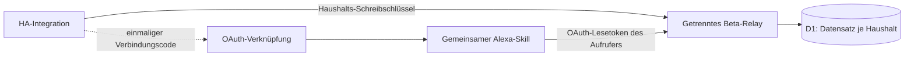

# Solaranlage über HACS – öffentliche Beta vorbereiten

**Entwicklungsstand, noch kein veröffentlichter Alexa-Skill.** Die laufende
Einzelanlage wird nicht automatisch umgestellt. HACS kann private Repositories
nicht installieren. Auf Wunsch wird das bestehende Repository
`kulmi84/solaranlage-echo-show` nach Prüfung öffentlich geschaltet.
Die gesicherten Quellcode-Stände bleiben als Branches erhalten.

## Der neue Ablauf für Nutzer

1. `https://github.com/kulmi84/solaranlage-echo-show` als benutzerdefiniertes Repository in HACS
   hinzufügen und **Solaranlage Echo Show** herunterladen. HA neu starten.
2. Einstellungen → Geräte & Dienste → Integration hinzufügen →
   **Solaranlage Echo Show**. Eine Einladung zur begrenzten Beta eingeben.
3. Live-Sensoren und kumulierte Energiezähler auswählen und der Übertragung
   zustimmen. Keine YAML-Dateien, HA-Zugangstoken oder eigenen Cloudflare-Konten.
4. In den Integrationsoptionen **Alexa verbinden** wählen. Den einmaligen,
   zehn Minuten gültigen Code kopieren. In der Alexa-App den gemeinsamen Skill
   aktivieren und den Code auf seiner Verknüpfungsseite einfügen.
5. „Alexa, öffne meine Solaranlage.“ Die bekannten Sprachfragen und beide
   Anzeigeseiten bleiben erhalten.

Der Verbindungscode ist lang, damit er nicht erraten werden kann. Er wird
kopiert und eingefügt, nicht auf dem Echo diktiert. Er ersetzt einen eigenen
Benutzernamen und ein Passwort beim Relay.

Die Skill-URL wird nach der Amazon-Freigabe ergänzt. Das Repository muss
für den HACS-Import öffentlich sein.
Bis dahin ist ein Test durch Kopieren des Ordners `custom_components/solaranlage_echo`
nach `/config/custom_components/solaranlage_echo` auf einer **getrennten Testinstanz**
möglich. Der HACS-Katalogeintrag ist ein späterer Schritt; zunächst reicht ein
öffentliches benutzerdefiniertes Repository.

## Sensorauswahl

- PV-Gesamtleistung in W/kW ist Pflicht und enthält das BKW bereits.
- Weitere Leistungen und Akkustand in Prozent sind optional.
- Energiezähler in Wh/kWh/MWh müssen kumulierte Recorder-Zähler sein
  (`total`/`total_increasing`). Keine täglich zurückgesetzten Anzeigehelfer.
- Der PV-Energiezähler enthält das separat gewählte BKW nicht bereits.
  Doppelt ausgewählte Energiezähler werden abgewiesen.
- Fehlende Werte bleiben unbekannt. Für die berechnete Hausenergie sind alle
  sechs Energiequellen erforderlich. Bei nicht vorhandenen BKW/Akku-Komponenten
  sind bewusst definierte Nullzähler erforderlich; Abwesenheit wird nicht geraten.

Live-/Tageswerte werden minütlich übertragen. Monat und Jahr werden beim Start
und nach einem Wechsel des lokalen Sechs-Stunden-Fensters ermittelt. Nach
vorübergehend fehlender Recorder-Statistik wird erneut versucht. Ein lokaler
Verbindungssensor zeigt letzten Upload, Status und fehlende Messwertarten.
Die Integration überträgt keine Entitäts-IDs oder HA-Zugangsdaten.

Die vorhandenen Statistiken bestimmen den verfügbaren Zeitraum. Daten aus
Zeiten vor der Recorder-Erfassung werden nicht nachträglich erfunden.

## Änderungen und Entfernen

Sensoren lassen sich in den Integrationsoptionen ändern. Änderungen laden die
Integration neu. **Relay-Daten und Verknüpfung löschen** entfernt nach ausdrücklicher
Bestätigung alle gespeicherten Relay-Messwerte und Zugriffsberechtigungen dieses
Haushalts. Anschließend die Integration in HA entfernen. Zum erneuten Einrichten
ist eine neue Einladung nötig.

Das bloße Entfernen der lokalen HA-Integration löscht Remote-Daten nicht. Wenn
HA nicht mehr erreichbar ist, muss der Betreiber den betreffenden Haushalt auf
Anfrage aus der Relay-Datenbank entfernen. Deshalb erst im Optionsdialog löschen.

## Betreiber: getrenntes Beta-Relay

Der neue Code liegt in `cloudflare/public-beta/`; er verwendet eine **neue**
D1-Datenbank und andere Tabellen. Den bestehenden Einzelanlagen-Worker nicht
ersetzen und die bisherige Datenbank nicht für diese Migration verwenden.

1. Neue D1-Datenbank erstellen; `wrangler.example.jsonc` in eine private
   `wrangler.jsonc` kopieren und nur deren neue Datenbank-ID einsetzen.
2. `schema.sql` auf diese neue Datenbank anwenden. `ADMIN_TOKEN` und
   `OAUTH_CLIENT_SECRET` als zwei getrennte zufällige 32-Byte-Secrets setzen.
   Nicht committen. Vorhandene produktive Secrets nicht wiederverwenden.
3. In der separaten Alexa-Entwicklungsversion Account Linking konfigurieren:

   | Einstellung | Wert |
   | --- | --- |
   | Verfahren | Authorization Code Grant, PKCE mit SHA-256 |
   | Authorization URI | `https://NEUES-RELAY/oauth/authorize` |
   | Token URI | `https://NEUES-RELAY/oauth/token` |
   | Client ID | `solaranlage-public-beta` |
   | Client Secret | eigenes `OAUTH_CLIENT_SECRET` |
   | Client-Authentifizierung | HTTP Basic oder Credentials im POST-Body |
   | Scope | `solar:read` |

4. Ausschließlich die **exakten Alexa Redirect URLs aus dieser Skill-Konsole**
   in `OAUTH_REDIRECT_URIS` als JSON-Liste eintragen. Keine Wildcards. Bei leerer
   Liste bleibt OAuth gesperrt. Worker deployen. `LIMITER` muss gebunden sein;
   ohne dieses Binding verweigert die API Anfragen.
5. In `custom_components/solaranlage_echo/const.py` den neuen Relay-Origin
   prüfen. Die Voreinstellung bezeichnet den vorgesehenen Beta-Worker und ist
   keine Zusicherung, dass er bereits bereitgestellt wurde.
6. Separate Alexa-Konfiguration nach `alexa/relay_config.public.example.json`
   erstellen, `mode: public_beta` und die neue `/v1/pv`-Adresse verwenden.
   `python build_skill.py` erzeugt das Backend. Nur die neue Skill-Testversion
   damit bereitstellen; die eigene laufende Skill-Version bleibt unangetastet.
7. Eine private Admin-Datei mit `relay_url` und `admin_token` erstellen. Einladung:

   ```sh
   python cloudflare/public-beta/admin.py --config .private/beta-admin.json --out .private/einladung-1.json
   ```

   Die Einladung ist einmalig und sieben Tage gültig. Sie enthält ein Geheimnis,
   ist nur für den jeweiligen Tester bestimmt und gehört nicht in GitHub.
   Höchstens 20 Haushalte können sich registrieren.

## Trennung und Grenzen



Tokens werden serverseitig nur gehasht gespeichert. Alexa bekommt ausschließlich
Lesezugriff auf den verknüpften Haushalt. Zugriffstokens gelten eine Stunde;
Refresh-Tokens rotieren und gelten maximal 90 Tage. Verknüpfungs- und
Autorisierungscodes sind einmalig. Löschung eines Haushalts widerruft alle Tokens.
IP-Limits und zeitliche Upload-Limits schützen vor einfachen Wiederholungen;
sie sind keine Garantie gegen verteilten Missbrauch oder gegen das Erreichen
der gemeinsamen Cloudflare-Kontolimits. Das Beta-Relay ist keine Steuer-API.

Es werden jeweils nur letzte Messwerte und aktuelle Tages-/Monats-/Jahresmengen
gespeichert, keine komplette Messwerthistorie. Ohne ausdrückliche Löschung
bleibt der letzte Haushaltsdatensatz bestehen. Abgelaufene Codes/Tokens räumt
ein täglicher Cron auf. Eine Datenschutzbeschreibung für den öffentlichen
Betrieb muss diese Speicherung, Betreiberkontakt und Löschmöglichkeit nennen.

## Stand der Prüfung und Freigabe

Automatisierte Tests prüfen Umrechnung, fehlende Werte, HA-Dialogübergänge,
Upload-Zeitsteuerung und Relay-Transport. Die HA-Framework-Grenzen verwenden
Test-Doubles; eine Installation in einer echten HA-Testinstanz steht noch aus.
Die Worker-Tests führen Registrierung, OAuth, PKCE, Token-Erneuerung und
Haushaltstrennung gegen eine echte lokale SQLite-Datenbank aus. Bestehende
Anzeige- und Sprachtests werden zusätzlich ausgeführt.

Das getrennte Beta-Relay wurde am 18. Oktober 2026 bereitgestellt. Ein Cloud-Smoke-Test
mit künstlichen Daten bestätigte Registrierung, Upload, Rollentrennung, Pairing
und widerrufende Löschung. Die Testdaten wurden entfernt. OAuth bleibt bis zur
Einrichtung der exakten Alexa-Rücksprungadressen gesperrt.

Vor dem öffentlichen Start fehlen:

- Installation und Kontoverknüpfung mit zwei getrennten echten Testhaushalten.
- Sichtbarkeit des geprüften Repositorys auf öffentlich umstellen; gegebenenfalls Brands-Beitrag.
- Betreiber-/Datenschutzseite und öffentliche Skill-Beschreibung.
- Amazon-Zertifizierung und anschließende Veröffentlichung des gemeinsamen Skills.

Eine GitHub-Aktualisierung veröffentlicht weder den Skill noch das Repository
und stellt keine weiteren Cloud-Dienste bereit. Die lokalen privaten Konfigurationen
bleiben außerhalb von Git; die Rückkehrpunkte bleiben erhalten.

Quellen: [HACS-Anforderungen](https://www.hacs.dev/docs/publish/integration/),
[Private Repositories](https://www.hacs.dev/docs/faq/private_repositories/),
[HA Config Flow](https://contributors.home-assistant.io/core/integrations/config-flow/),
[Amazon Account Linking](https://developer.amazon.com/docs/alexaplus/account-linking/configure-authorization-code-grant.html).
