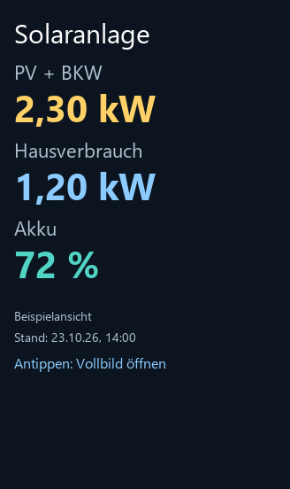

# Optionales Solaranlagen-Widget

**Zusätzlich zur bewährten Vollbildansicht.** PV-Leistung, Hausverbrauch und Akkustand werden zusammen mit
dem Empfangsstand angezeigt und im Hintergrund regelmäßig aktualisiert. Ein Tipp öffnet die bestehende
große Ansicht. Darstellung, bisheriger Sprachaufruf, Bild-Aktualisierung und Sitzungsverhalten bleiben gleich.

Die Widget-Erweiterung ist im normalen Entwickler-Skill installiert. Allgemeine Verfügbarkeit in der
Widget-Galerie folgt erst nach erneuter Amazon-Zertifizierung. HACS installiert das Alexa-Widget nicht.
Auf kleineren Echo Shows wird das Widget über Widget-Verknüpfungen geöffnet; Größe und Platzierung bestimmt Amazon.

## Größeres Layout

Werte stehen untereinander unter ihren Bezeichnungen. Schriftgröße der Werte: 42 statt ursprünglich 24.
Der neue Entwurf ist gespeichert, aber noch nicht auf dem Gerät: Amazon blockiert den nötigen Build
während der laufenden Zertifizierung. Vollbildansicht, Sprachaufruf und Datenübertragung bleiben unverändert.
Die Abbildungen sind Vorschauen mit ausdrücklich gekennzeichneten Beispielwerten.

[Vorher/nachher und Screenshot aus dem Editor](../widget/README.md#layoutstand)

[Technik, Prüfungen und Rückkehr zur v1.0.6](../widget/README.md)
