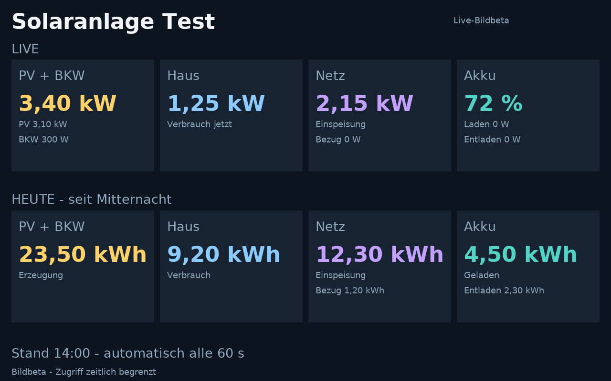
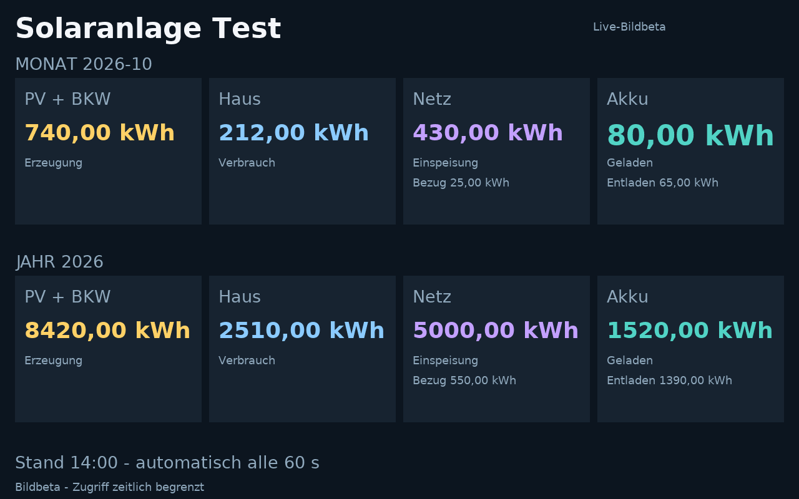

# Solaranzeige sichtbar halten und Alexa für Sprachbefehle freigeben – separate Beta

## Kernänderung: Anzeige bleibt sichtbar, Alexa kann wieder zuhören

**Die Solaranzeige bleibt im Vollbild sichtbar und aktualisiert ihre Werte, während die Sprachsitzung des Skills bereits geschlossen ist. Alexa kann dadurch normale Sprachbefehle entgegennehmen, ohne dass die Solaranzeige vorher ausdrücklich beendet werden muss.**

Der bisherige native Stand zeigte die Live-Werte erfolgreich an. Im beobachteten Vollbildbetrieb reagierte Alexa jedoch auf normale Fragen und Smart-Home-Befehle nicht zuverlässig; die Anzeige gab die Sprachsteuerung nicht zuverlässig frei. Erst eine Frage nach der Uhrzeit machte weitere Befehle wieder nutzbar. Das war der Ausgangspunkt für diese separate Beta.

Die Beta trennt deshalb die sichtbare Anzeige von der Sprachsitzung. Die Messwertbilder werden auch bei geschlossener Sprachsitzung nachgeladen. Unbekannte Befehle sollen nicht durch eine dauerhaft offene Skill-Sitzung abgefangen werden.

**Alexa entscheidet weiterhin selbst über die Zuordnung einer Anfrage.** Der Skill kann eine an ihn zugestellte Wetterfrage nicht an Alexa weiterreichen. Wetterinformationen oder Smart-Home-Karten können die Solaranzeige ersetzen; eine automatische Rückkehr zur Vollbildansicht ist nicht vorgesehen. Das Verhalten am Echo Show bleibt Teil des Gerätetests.

Diese Variante hält Überschriften, Kacheln und Bedienelemente als native APL-Komponenten auf dem Echo Show. Nur die Messwertbereiche sind kleine PNG-Bilder. Das reduziert das sichtbare Aufblinken gegenüber einem neu geladenen Vollbild. Die Sprachsitzung bleibt geschlossen; die Bilder werden lokal über `SetValue` nachgeladen.

Die Standarddateien `beta_live_lambda.py`, `build_skill.py`, die HACS-Integration und der produktive Relay-Worker werden durch diesen Vorschlag nicht ersetzt. Es gibt keine automatische Bereitstellung oder neue HACS-Version.

## Umfang

- Live/Heute: PV inklusive BKW, Hausverbrauch, Netzbezug und Einspeisung, Akkustand, Laden/Entladen sowie Tagesenergien.
- Monat/Jahr: Erzeugung, Verbrauch, Netz- und Akkuenergien.
- Acht getrennte Wertebilder je Seite; regelmäßiger Abruf alle 60 Sekunden für die sichtbare Seite.
- Nach Ladefehlern erneuter Versuch nach zehn Sekunden. Ein erfolgreicher Abruf setzt den Fehlerhinweis zurück.
- Lokaler Seitenwechsel und manuelles Aktualisieren ohne `SendEvent`.
- Uhrbild, Tick, Versuche und Bildzähler bleiben zur Diagnose erhalten. „Versuche“ gehört zum alten SendEvent-Test und zählt nicht die PNG-Abrufe.
- Keine doppelt gepufferten Bilder: Beide Versuche damit wurden am echten Echo Show verworfen, obwohl der Simulator Aktualisierungen zeigte.

## Beispielansichten

Die folgenden Bilder zeigen den PNG-Renderer mit **synthetischen Beispielwerten**, keine privaten Messwerte und keine Geräteaufnahmen. In der Beta werden die Wertebereiche daraus einzeln in native Kacheln gesetzt.




## Separat aufbauen

Voraussetzung ist die vorhandene Kontoverknüpfung des eigenen Test-Skills mit dem Lesebereich `solar:read`. Eine reine HACS-Aktualisierung aktiviert diese Variante nicht. Für die bestehende Testinstallation ist kein neuer HA-Upload nötig.

1. `python build_live_images.py` in diesem Verzeichnis ausführen. Das erzeugte `image-live/lambda_function.py` ist syntaktisch mit Python 3.8 kompatibel.
2. `worker/wrangler.example.jsonc` nach `worker/wrangler.jsonc` kopieren und einen **separaten** Testworker verwenden. Die beiden erwarteten Hostnamen in `live_image_runtime.py`, `diagnostic_display.py` und `worker/sessions.mjs` müssen zur eigenen Testumgebung passen; der Relay-Upstream bleibt fest konfiguriert.
3. Zwei unabhängige Schlüssel erzeugen, beispielsweise zweimal `python -c "import secrets; print(secrets.token_hex(32))"`. `SESSION_KEY` und `DISPLAY_KEY` als Worker-Secrets setzen. Niemals echte Schlüssel in `.secrets.example.json` eintragen oder committen.
4. Nur den separaten Bildworker bereitstellen. Er erhält keine Datenbankbindung. Seine einzige Datenquelle ist die fest eingestellte `/v1/pv`-Leseroute des Relays.
5. `relay_config.example.json` privat als `relay_config.json` neben die gebaute Lambda-Datei legen. `image_session_key` ist derselbe Wert wie `SESSION_KEY`; `DISPLAY_KEY` verbleibt ausschließlich im Worker.
6. Lambda und private Konfiguration ausschließlich in den gewünschten Test-Skill hochladen und dessen Entwicklungsstand bereitstellen. Nicht „Promote to live“ wählen.
7. Den Test-Skill in der Alexa-App separat verknüpfen und mit „Alexa, öffne meine Solaranlage Test“ starten.

Ohne Kontoverknüpfung oder bei fehlgeschlagenem Bildzugang zeigt die Beta einen Hinweis. Das Diagnosegerüst enthält keine Demo-Messwerte; Solar-Sprachantworten lesen die echten Werte über den vorhandenen Reader.

## Bildzugriff und Laufzeit

Der Bilddienst prüft bei der Vergabe das OAuth-Lesetoken gegen den festen Relay-Upstream. Die Bildadresse enthält einen authentifiziert verschlüsselten Zugang (AES-GCM), der maximal eine Stunde gilt. Jeder Bildabruf prüft ihn erneut und fragt das Relay mit diesem Lesetoken ab. Es gibt keine öffentlich lesbare Messwertadresse und keine frei wählbare Upstream-URL. Bildadressen sind trotzdem vertraulich: Wer eine gültige Adresse besitzt, kann bis zu deren Ablauf die zugehörigen Werte lesen. Sie gehören weder in Issues noch in Screenshots oder Logs.

Redirects werden nicht verfolgt; Nicht-2xx-Antworten werden abgelehnt. Antworten sind größenbegrenzt, werden nicht gecacht und enthalten keine Kontotoken im Klartext. Observability bleibt im Beispiel deaktiviert. Der separate Uhrbild-Endpunkt enthält keine Haushaltsdaten.

Der Zugang wird bei geschlossener Sprachsitzung nicht automatisch verlängert. Nach Ablauf muss der Skill erneut geöffnet werden. Der Datenstand und Fehlerhinweise sind deshalb Teil des Tests.

## Prüfen

```text
python -m unittest -q test_live_images
node --test worker/worker.test.mjs worker/sessions.test.mjs
```

Sieben Python-Tests und elf Worker-Tests prüfen unter anderem Kontoverknüpfung, echte Sprachantworten, Ablauf/Manipulation, Zugriffsschutz, begrenzte Koordinaten und alle 16 Wertebilder.

Die geglättete Schrift im öffentlichen Paket wird aus der mit ReportLab verteilten, weiterverteilbaren Schrift erzeugt; siehe `worker/FONT-LICENSE.txt`. Zum reproduzierbaren Neuaufbau: Abhängigkeiten aus `requirements-dev.txt` installieren und `python worker/build_font.py` ausführen. Der laufende private Beta-Prototyp verwendete zuvor einen lokalen Windows-Font; der PR enthält keine Windows-Schriftdateien.

## Vor einer Live-Übernahme offen

- Längeren Gerätetest der vollständigen Ansicht und mehrerer Aktualisierungen bestätigen. Der Betreiber hat den Einzelbild-Test als deutlich unauffälliger bewertet. Der vollständige Aufbau wurde bislang im Simulator geprüft.
- Die Beta-Diagnoseanzeigen vor einer Live-Übernahme entfernen. Einzelne Kachel-Uhrzeiten sind bereits durch einen gemeinsamen Datenstand ersetzt.
- Ablauf nach einer Stunde und zeitweise nicht verfügbare Daten sichtbar am Gerät prüfen.
- Zusätzliche Worker-Aufrufe und Betriebsgrenzen für mehr als die private Testinstallation bewerten. Dieser PR aktiviert keinen kostenpflichtigen Tarif.

## Rückkehr

Der bisherige native Produktionsstand bleibt als [Release v1.0.5](https://github.com/kulmi84/solaranlage-echo-show/releases/tag/v1.0.5) und im [Archivzweig](https://github.com/kulmi84/solaranlage-echo-show/tree/codex/archive-v1.0.5-native-apl) erhalten. Zur Rückkehr muss der zentrale Alexa-Code aus diesem Stand bereitgestellt werden; ein HACS-Downgrade allein genügt nicht. Die private Komplettsicherung mit Konfiguration bleibt außerhalb des öffentlichen Repositorys.

## Layoutanpassung am 21. Oktober 2026

Das native Gerüst übernimmt die bisherigen Maße: 3 vw Seitenrand, 10 vh Kopfzeile, 30 vh je Kachelreihe, 23 vw Kachelbreite, 14 dp Rundung, 3,4 vh Kachelbeschriftung und Wertebilder passend zu den bisherigen Schriftgrößen. Die Navigation steht wieder oben. Live/Heute und Monat/Jahr nutzen den vollen Bildschirm; die Diagnose bleibt am unteren Rand der Beta. Der vorherige kompakte Beta-Aufbau bleibt im Archivzweig `codex/archive-beta-before-final-layout` erhalten. Die private Komplettsicherung enthält zusätzlich den tatsächlich eingesetzten Windows-Schriftatlas und die privaten Konfigurationen.
