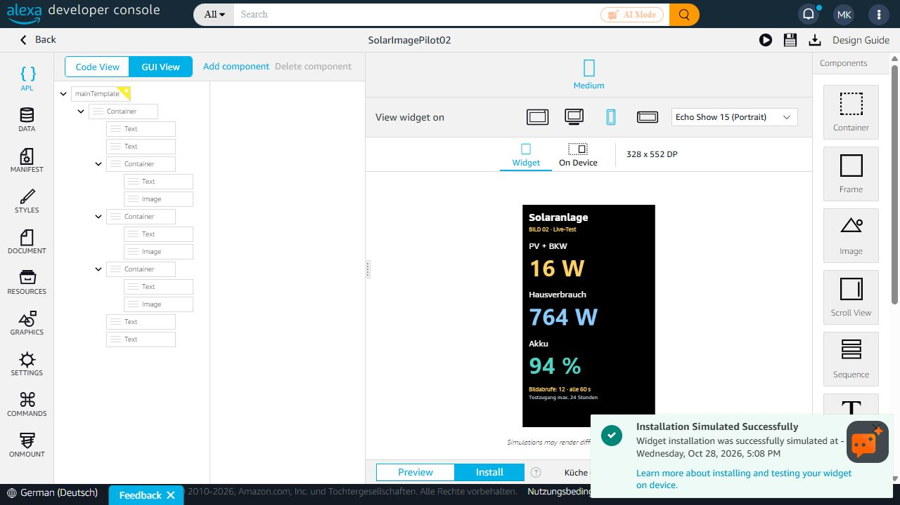

# Transparente Widget-Bilder: Kandidat für die finale Fassung

**Stand 28. Oktober 2026: Quellcode und Tests hinterlegt, noch keine finale Veröffentlichung.**

Der Bildweg zeigt PV + BKW, Hausverbrauch und Akkustand als transparente PNGs. Das Widget lädt diese Bilder alle 60 Sekunden neu, wenn Alexa seinen Timer ausführt. Dadurch benötigt die Werteanzeige keinen Alexa Data Store. Die funktionierende normale Vollbildansicht wird durch diesen Kandidaten nicht verändert.

## Zwei getrennte Entwicklungswege

| Weg | Status und weiteres Vorgehen |
| --- | --- |
| Bild-Widget | BILD 02 mit transparenten Werten wurde auf dem Echo vom Nutzer als funktionierend bestätigt. BILD 03 ergänzt einen dauerhaft widerrufbaren Bildzugang und ist für den Mehrtagetest vorbereitet. Bei dauerhaft erfolgreichem Test soll dies die finale Widget-Lösung werden. |
| Data-Store-Widget | Weiterhin ohne zuverlässigen Werteempfang. Weitere Versuche sollen ausschließlich in der separaten Beta erfolgen. [Issue #7](https://github.com/kulmi84/solaranlage-echo-show/issues/7) bleibt offen; dieser Bildweg beweist keine Behebung des Data-Store-Problems. |

**BILD 03 wurde zu diesem Dokumentationsstand noch nicht auf dem Echo installiert.** Browserzugriff war für den Amazon-Schritt deaktiviert. Ein simulierter Test über sieben Tage ist kein bestandener Mehrtagetest auf dem Gerät. Weder Amazon-Zertifizierung noch Store-Rollout werden mit diesem Quellcode-PR ausgelöst.

## Ansicht

Die bestätigte transparente BILD-02-Vorschau und Amazons Installationsbestätigung:



Diese Aufnahme dokumentiert BILD 02, nicht eine bereits installierte BILD-03-Fassung. Das Layout von BILD 03 bleibt gleich: native Beschriftungen, vollständig eingepasste Wertebilder (`best-fit`) und ausreichende Abstände. Die Vorschau enthält Momentaufnahmen, keine fest hinterlegten Live-Werte.

## Bildzugang und 24 Stunden

Der alte Bildtest übernahm eine beim Öffnen des normalen Skills erzeugte Bildfreigabe mit maximal 24 Stunden Laufzeit. Wegwischen verlängert diese Freigabe nicht. Auch der geprüfte Vollbildcode erhält beim Öffnen seine eigene zeitlich begrenzte Freigabe; dieser PR ändert sie nicht.

BILD 03 verlängert nicht einfach den alten Vollbildtoken. Es verwendet einen separaten zufälligen 256-Bit-Widgetschlüssel. Der Worker speichert nur dessen SHA-256-Hash sowie die exakt verifizierte Haushaltszuordnung und Widerrufskennung. Jede Anfrage prüft diese Zuordnung erneut und liest per festem `SELECT` ausschließlich die drei benötigten Werte. Die Widgetadresse enthält weder OAuth-Zugangsdaten noch einen auswählbaren Haushalt.

Der Zugang hat keinen täglichen Ablauf. Löschen/Deaktivieren der zugeordneten Anlage oder Ändern ihrer Freigabekennung sperrt ihn. Der Betreiber kann zusätzlich den eigenen Widgetschlüssel ersetzen oder den separaten Dienst abschalten. Bloßes Entfernen des Widgets widerruft den Bildschlüssel derzeit nicht automatisch. Der Schlüssel bleibt vertraulich und muss wie ein Zugangstoken behandelt werden.

Der D1-Bindingzugang ist auf Plattformebene keine schreibgeschützte DB-Rolle. Der hier veröffentlichte Handler verwendet ausschließlich feste SELECT-Anweisungen; keine Quelltabellen oder Produktionsschemas werden geändert. Antworten sind `no-store`; Observability bleibt deaktiviert, damit vertrauliche Bildadressen nicht geloggt werden.

## Enthaltener Code

- `worker.mjs`: getrennter Widget-Bilddienst, nur Spalten 0/1/3, Widerrufsprüfung bei jeder Anfrage.
- `transparent-png.mjs`: Umwandlung des bekannten 263×154-PNG-Formats in transparente 263×64-Wertebilder, geglättete Schriftkanten bleiben erhalten.
- `document.template.json` und `manifest.json`: bereinigte BILD-03-Vorlagen ohne echten Bildzugang.
- `build_widget.py`: setzt eine **lokale private** Bildadresse ein; erzeugte Pakete gehören ausschließlich in einen ignorierten privaten Ausgabeordner.
- `worker.test.mjs`: Tests ohne Cloudflare-Zugang oder echte Messwerte.
- `wrangler.example.jsonc`: Platzhalterkonfiguration für eine eigene, separate Worker-Instanz.

Der unveränderte Renderer und seine Schrift werden aus `../../cloudflare/display/` importiert. Dessen vorhandene Schriftlizenz bleibt maßgeblich. Es werden keine Produktionsdateien überschrieben.

## Lokal prüfen

Vom Repository-Stamm mit einer aktuellen Node-Version:

```powershell
node experiments/widget-image/worker.test.mjs
```

Geprüft werden transparente Bilder, wechselnde Messwerte, ein simulierter Zeitsprung von sieben Tagen, Ablehnung falscher Schlüssel vor dem DB-Zugriff, Beschränkung auf drei Spalten sowie Widerruf bei gelöschter oder geänderter Anlagenfreigabe. Echte HTTPS-Abrufe aller drei PNGs wurden im privaten Dienst ebenfalls geprüft.

## Betreiber-Einrichtung des Prototyps

Dies ist noch kein öffentlicher Ein-Klick-Einrichtungsweg. Der Betreiber richtet eine **separate** Worker-Instanz mit `SOURCE_DB` auf der vorhandenen Quelle ein. Die Beispielkonfiguration enthält absichtlich weder Konto- noch Datenbankkennungen. Keine neue Messwert-Datenbank ist erforderlich.

Als Worker-Secret wird `WIDGET_READ_GRANT` benötigt: ein JSON-String mit `tokenHash`, `tenant` und `version`. `tokenHash` ist SHA-256 des zufälligen 64-stelligen Hexschlüssels; `version` ist SHA-256 der verifizierten `write_hash`-Kennung desselben Haushalts. Die exakte Zuordnung muss aus der bereits authentifizierten Anlagenverbindung stammen. Keine Auswahl nach ähnlichen Werten oder dem zuletzt berichtenden Haushalt. Der veröffentlichte Worker hat keinen öffentlichen Einrichtungsendpunkt.

Eine lokale, ignorierte Datei enthält anschließend `image_base` mit der eigenen HTTPS-Adresse `/value.png?k=...`. Nicht in GitHub, Issues, Screenshots oder Buildlogs übernehmen.

```powershell
python experiments/widget-image/build_widget.py --image-config .private/widget-image-config.json
```

Die generierten Dateien liegen in `experiments/widget-image/private-output/`. Nur diese privaten Artefakte werden für einen gezielten Amazon-Development-Build verwendet. Nicht gleichzeitig mehrere identisch benannte Testpakete installieren. Der Quellcode allein installiert nichts auf dem Echo.

## Freigabekriterien

Vor der Übernahme als finale Widget-Version müssen auf dem Gerät mindestens folgende Punkte bestätigt sein:

- BILD 03 ist eindeutig installiert; laufende Messwerte ändern sich über mehr als 24 Stunden.
- Wechsel zwischen Startseiten, Hintergrundphasen und ein Neustart unterbrechen den Zugang nicht dauerhaft; bei Rückkehr erscheinen aktuelle Werte.
- Kein tägliches Neuöffnen, Neuverknüpfen oder Neuinstallieren ist erforderlich.
- Ausfälle und veraltete Daten werden verständlich angezeigt; alte Werte dürfen nicht als aktuelle Werte erscheinen.
- Antippen öffnet die **normale** Vollbildansicht. Der aktuelle isolierte Bildtest enthält noch keine Tippaktion; diese muss vor finaler Freigabe ergänzt und getestet werden.
- Die bestehende normale Vollbildansicht, Sprachsteuerung und Aktualisierung bleiben unverändert.

Danach erfolgt die Übernahme und gegebenenfalls notwendige Amazon-Prüfung. Bis dahin bleiben der aktuelle Produktionsstand und seine Rücksprungstände erhalten. Das Data-Store-Widget wird separat in der Beta untersucht, ohne den erfolgreichen Bildtest zu verändern.
