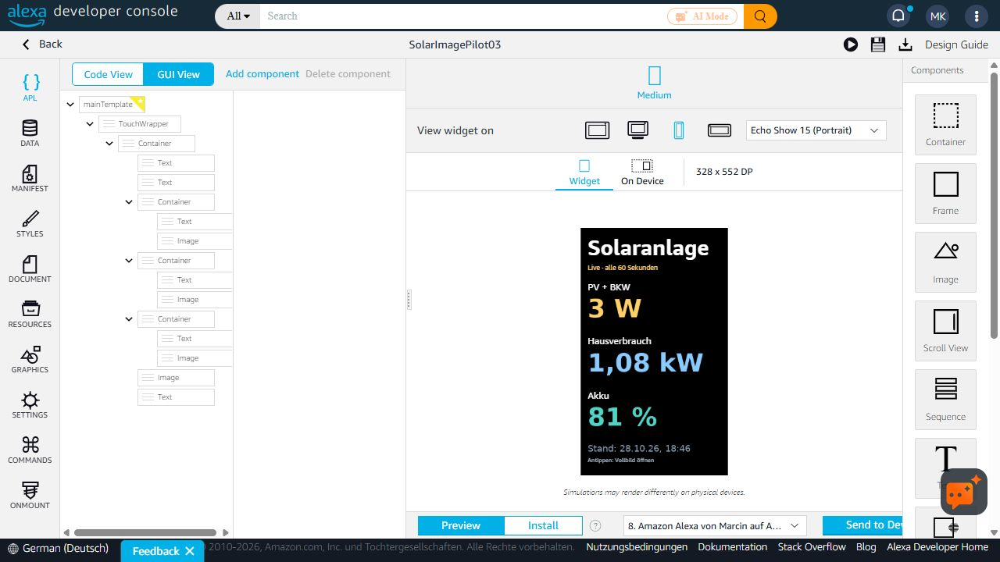

# Solaranlage: Bild-Widget

**v1.0.8: Am 28. Oktober 2026 auf dem Echo Show vom Betreiber bestätigt und zur Übernahme freigegeben.**

Das Widget zeigt PV + BKW, Hausverbrauch und Akkustand als transparente Bilder. Es ruft sie alle 60 Sekunden ab, solange Alexa den Widget-Timer ausführt. Die Stand-Zeile zeigt die tatsächliche Empfangszeit der Messwerte in der Zeitzone der Anlage. Sie wird mit 789×84 Pixeln, voller Alpha-Transparenz und geglätteten Schriftkanten gerendert. Nach drei Minuten ohne frische Daten erscheint „Veraltet“. Antippen öffnet über `solar.widget.open.v1` die bestehende normale Vollbildansicht.



Die Aufnahme dokumentiert das Layout; die Zahlen sind Momentaufnahmen. Die Korrektur der Stand-Schrift wird vom Bilddienst geliefert und erfordert keine Neuinstallation. Der aktuelle Bildzugang hat keinen täglichen 24-Stunden-Ablauf. Ein simulierter Sieben-Tage-Test ersetzt keinen echten Mehrtagetest.

## Veröffentlichung und Kontozuordnung

Der bestätigte Gerätetest verwendet ein **privat erzeugtes, einer Anlage zugeordnetes Paket**. Es ist kein bereits für alle Konten veröffentlichtes Store-Widget. Ein HACS-Update installiert oder veröffentlicht dieses Widget nicht.

Das Paket enthält einen privaten Bildschlüssel. Deshalb darf ein für eine reale Anlage erzeugtes Paket weder in GitHub noch als gemeinsames Amazon-Store-Paket veröffentlicht werden. Vor einer allgemeinen Store-Verteilung muss jedes verknüpfte Konto seinen eigenen widerrufbaren Bildzugang erhalten. Diese automatische Bereitstellung ist noch nicht implementiert. Die öffentliche Vorlage enthält ausschließlich Platzhalter; sie zeigt ohne private Einrichtung keine Werte.

Der normale Skill, seine Statusansage, der Sprachaufruf und die Vollbildansicht bleiben unverändert. Der frühere Data-Store-Weg wird für die finale Widget-Lösung ersetzt; seine zugrunde liegende Amazon-Ursache ist weiterhin ungeklärt. Weitere Data-Store-Versuche gehören ausschließlich in die separate Beta. [Issue #7](https://github.com/kulmi84/solaranlage-echo-show/issues/7) dokumentiert Diagnose und Ablösung.

## Lesezugang und Widerruf

Der separate Worker verwendet einen zufälligen 256-Bit-Schlüssel. Serverseitig liegen nur SHA-256-Schlüsselhash, exakt verifizierte Haushaltszuordnung und Widerrufskennung. Jede Anfrage liest per festem SELECT nur die drei Werte und Empfangszeit dieses Haushalts. Keine Auswahl anhand ähnlicher Werte oder des zuletzt aktiven Haushalts. Löschen/Deaktivieren der Anlage oder eine geänderte Freigabekennung sperrt den Zugang. Der Betreiber kann den Schlüssel ersetzen oder den separaten Dienst abschalten. Entfernen eines Widgets widerruft den Schlüssel derzeit nicht automatisch.

Die technische D1-Bindung ist keine schreibgeschützte Datenbankrolle; der Handler verwendet ausschließlich feste SELECT-Anweisungen. Keine Quelltabellen oder Produktionsschemas werden verändert. Antworten verwenden `no-store`, Observability bleibt deaktiviert. Private Bildadressen, Bindungen und Konfigurationen niemals veröffentlichen.

## Quellcode und Tests

- `worker.mjs`: getrennter Bilddienst, Berechtigungsprüfung vor Datenabruf, genau drei Spalten und Status.
- `transparent-png.mjs`: transparente Wertebilder, unveränderter vorhandener Renderer unter `cloudflare/display`.
- `status-png.mjs` und `status-font.mjs`: hochauflösende Stand-Zeile, Zeitumrechnung und Veraltungswarnung. Die Schriftdatei enthält gerasterte Glyphen, keine TTF-Datei.
- `document.template.json` und `manifest.json`: bereinigtes Paket `SolarImageStatus102` 1.0.2, TouchWrapper und 60-Sekunden-Timer.
- `build_widget.py`: setzt ausschließlich lokal eine private Bildadresse ein; Ausgabe nur in ignorierten privaten Ordnern.
- `wrangler.example.jsonc`: Platzhalter für eine eigene separate Instanz, keine echten Konto-/Datenbankkennungen.

```powershell
node experiments/widget-image/worker.test.mjs
python experiments/widget-image/build_widget.py --image-config .private/widget-image-config.json
```

Der Worker benötigt `SOURCE_DB` sowie das Secret `WIDGET_READ_GRANT` mit `tokenHash`, `tenant` und `version`. Die Konfigurationsdatei enthält `image_base` mit der eigenen HTTPS-Adresse `/value.png?k=...`. Der Builder leitet daraus auch die geschützte Statusadresse ab. Der Schlüssel muss aus einer authentifizierten Anlagenverbindung zugeordnet werden. Es gibt keinen öffentlichen Einrichtungsendpunkt.

Geprüft: transparente und wechselnde Wertebilder, hochauflösende Statusbilder, fehlende/falsche Schlüssel, Ablehnung vor Datenbankzugriff, Spaltenbeschränkung, Zeitzone, veraltete Daten, simulierter Sieben-Tage-Zeitsprung und Widerruf. Echte HTTPS-Abrufe des privaten Dienstes erfolgreich. Gerätedarstellung vom Nutzer bestätigt; eine allgemeine Amazon-Store-Freigabe wird damit nicht behauptet.
